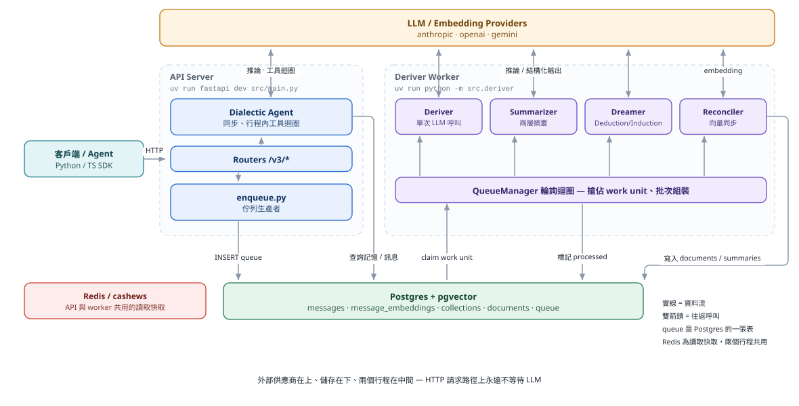
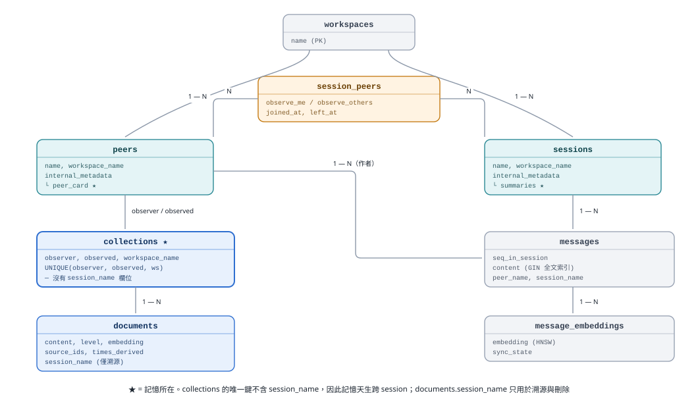
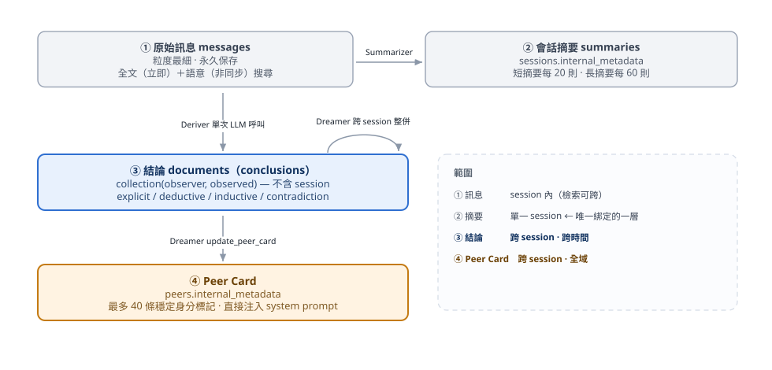
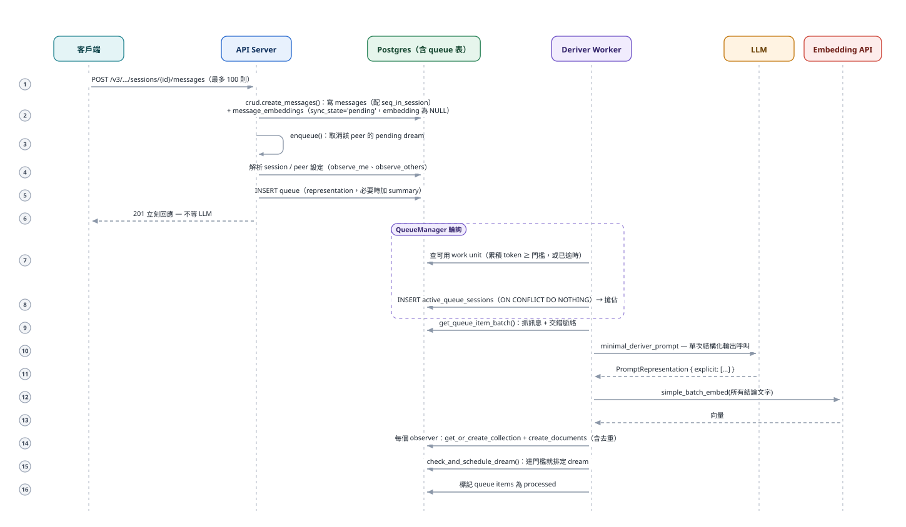
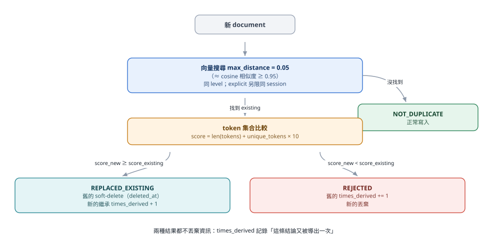
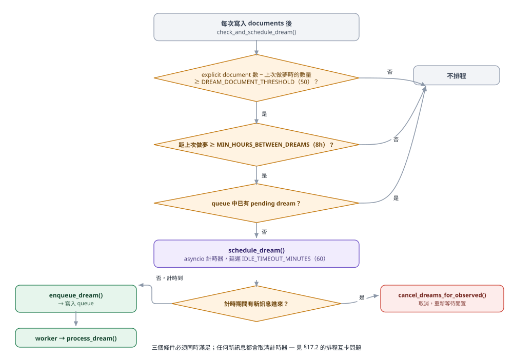
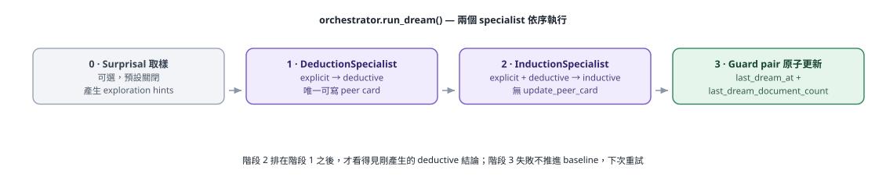
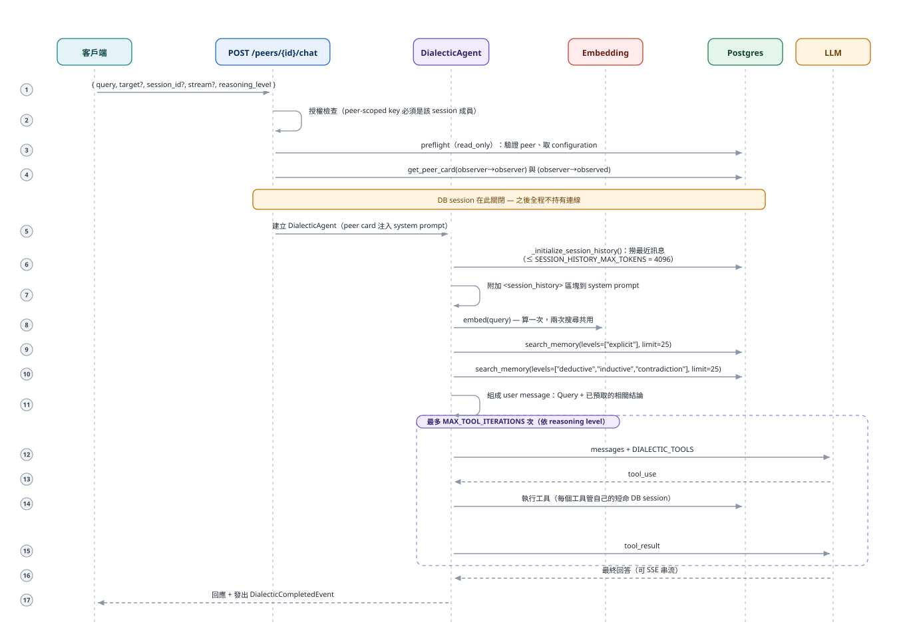
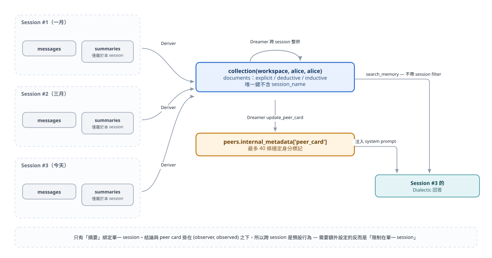

# Honcho 架構與記憶系統完整說明

> 本文件以繁體中文撰寫，內容全部對照 `src/` 目前的實作。凡是提到程式符號（函式、設定、資料表欄位）時一律使用程式碼中的原始名稱。
>
> **圖表**：本文所有圖表為 `assets/architecture/*.svg`，由 `assets/architecture/generate.py` 產生（`python3 assets/architecture/generate.py`）。SVG 會跟隨系統的淺色／深色主題切換配色。
>
> **術語對照**：對外 API 與文件稱為 **conclusion（結論）** 的東西，在程式碼中的符號名稱是 **observation（觀察）**（`create_observations`、`delete_observations`、`get_observation_context` …）。兩者是同一件事，本文敘述使用「結論／觀察」交替，引用程式碼時保留原名。

---

## 目錄

1. [Honcho 是什麼](#1-honcho-是什麼)
2. [執行期架構（兩個行程）](#2-執行期架構兩個行程)
3. [核心概念與資料模型](#3-核心概念與資料模型)
4. [記憶的四個層次](#4-記憶的四個層次)
5. [寫入路徑：訊息如何變成記憶](#5-寫入路徑訊息如何變成記憶)
6. [佇列與 Work Unit：順序、批次與併發控制](#6-佇列與-work-unit順序批次與併發控制)
7. [去重與強化：記憶如何收斂](#7-去重與強化記憶如何收斂)
8. [Dreamer：記憶的整併與自我提升](#8-dreamer記憶的整併與自我提升)
9. [Summarizer：兩層會話摘要](#9-summarizer兩層會話摘要)
10. [Reconciler：非同步向量化與清理](#10-reconciler非同步向量化與清理)
11. [讀取路徑：Dialectic 如何回想](#11-讀取路徑dialectic-如何回想)
12. [記憶機制總整理](#12-記憶機制總整理)
13. [跨 Session 記憶的方法（重點）](#13-跨-session-記憶的方法重點)
14. [檢索機制細節：混合搜尋與向量儲存](#14-檢索機制細節混合搜尋與向量儲存)
15. [設定參數速查](#15-設定參數速查)
16. [一致性、失效模式與保證](#16-一致性失效模式與保證)
17. [系統優點與缺點分析](#17-系統優點與缺點分析)
18. [附錄：關鍵檔案索引](#18-附錄關鍵檔案索引)

---

## 1. Honcho 是什麼

Honcho 是一個「給 AI agent 用的記憶與社會認知基礎設施層」。它的職責不是產生對話回覆，而是：

- 從訊息流中**萃取**關於參與者的事實與推論，長期累積
- 把這些累積的知識在**需要的時候**（just-in-time）以自然語言形式注入回 agent
- 讓同一個使用者在**不同 session、不同時間、甚至不同 agent** 之間保持一致的身分與脈絡

核心設計信念：**與其手工設計記憶結構，不如讓 LLM 自己讀對話、寫下結論，再讓另一個 LLM 在回答時把結論找回來。** 因此 Honcho 的「記憶」本質上是一堆**自然語言句子 + 向量**，而不是結構化的 schema。

---

## 2. 執行期架構（兩個行程）

Honcho 在執行期是**兩個互相合作的行程**，共用一個 Postgres（含 pgvector）與一個 Redis 快取。



| 行程 | 進入點 | 職責 | 是否可水平擴展 |
|---|---|---|---|
| **API Server** | `src/main.py` | 處理 HTTP、寫訊息、把工作丟進佇列後立刻回應；**行程內同步執行 Dialectic** | 是 |
| **Deriver Worker** | `src/deriver/__main__.py` → `queue_manager.main()` | 佇列消費者（uvloop），跑 Deriver / Summarizer / Dreamer / Reconciler | 是（`DERIVER_WORKERS`，多實例安全） |

**關鍵設計原則：HTTP 請求路徑上絕不阻塞於背景 LLM 工作。** 唯一在同步請求路徑上呼叫 LLM 的是 Dialectic（`/chat`），因為那本來就是「使用者在等答案」的場景。

另一條鐵律（見 `CLAUDE.md`）：**永遠不要在持有 DB session 的情況下做外部呼叫**（LLM、embedding、HTTP）。程式碼中到處可見「先關掉 DB session → 呼叫 LLM → 再開一個短命 session 寫回」的模式，例如 `RepresentationManager.save_representation()` 先 `embedding_client.simple_batch_embed()`，之後才 `async with tracked_db(...)`。

---

## 3. 核心概念與資料模型

### 3.1 Peer Paradigm

Honcho 不區分「使用者」與「agent」，兩者統一是 **Peer**。這讓以下情境自然成立：

- 一個 session 裡有多個人類 + 多個 AI
- 每個 peer 可以設定要不要觀察別人（`observe_others`）、要不要被觀察（`observe_me`）
- 「agent 對使用者的印象」與「使用者對自己的記錄」用同一套機制表達

### 3.2 主要資料表（`src/models.py`）



| 資料表 | 角色 | 記憶相關重點 |
|---|---|---|
| `workspaces` | 最上層租戶單位 | 所有資料的根 |
| `peers` | 參與者 | **`internal_metadata` 裡存 peer card** |
| `sessions` | 對話脈絡 | **`internal_metadata["summaries"]` 裡存短／長摘要** |
| `messages` | 原始訊息 | `seq_in_session` 保證會話內順序；`content` 上有 GIN 全文索引 |
| `message_embeddings` | 訊息向量 | 與 `messages` **分開的表**，有自己的 `sync_state`，HNSW 索引 |
| `collections` | 記憶容器 | **唯一鍵 = `(observer, observed, workspace_name)`** ← 跨 session 記憶的根本 |
| `documents` | 一條結論／觀察 | `level`、`times_derived`、`source_ids`、`session_name`、`embedding`、`deleted_at` |
| `queue` | 背景工作佇列 | `work_unit_key`、`task_type`、`payload`、`processed` |
| `active_queue_sessions` | 工作單元佔用鎖 | `work_unit_key` 為 UNIQUE → 一個 work unit 同時只有一個 worker |

### 3.3 多租戶：複合外鍵

幾乎每個複合外鍵都包含 `workspace_name`：

```python
ForeignKeyConstraint(
    ["observer", "observed", "workspace_name"],
    ["collections.observer", "collections.observed", "collections.workspace_name"],
)
```

這使得**跨 workspace 的資料外洩在 schema 層級就不可能發生**，不需要靠應用層記得加 where 條件。

### 3.4 Collection：`(observer, observed)` 這一對才是記憶的主鍵

這是理解整個 Honcho 記憶模型最重要的一件事：

```
collection = (workspace, observer, observed)
```

- `observer == observed` → **自我表徵**（peer 對自己的知識，也就是「Honcho 全知視角」的個人檔案）
- `observer != observed` → **跨 peer 模型**（「A 眼中的 B」）

**注意 `collection` 沒有 `session_name` 欄位。** 記憶天生就是跨 session 的；`session_name` 只出現在 `documents` 上，作為「這條結論是從哪個 session 推導出來的」溯源資訊，**不是**檢索時的預設過濾條件。

### 3.5 Document 的四個 level

| level | 產生者 | 意義 | `source_ids` |
|---|---|---|---|
| `explicit` | Deriver | 訊息中直接陳述的原子事實 | 無（premises 為 None） |
| `deductive` | Dreamer DeductionSpecialist | 從 explicit 邏輯必然推出的結論 | 有（premises 的 document id） |
| `inductive` | Dreamer InductionSpecialist | 從多條觀察歸納出的模式／個性 | 有（sources 的 document id） |
| `contradiction` | Dreamer（`create_observations`） | 記錄互相矛盾的陳述 | 有 |

`source_ids` 上有 GIN 索引（`ix_documents_source_ids_gin`），支撐 **推理樹**（reasoning tree）的雙向走訪：由結論往上找前提，或由前提往下找衍生結論（`get_reasoning_chain` 工具）。

---

## 4. 記憶的四個層次

Honcho 的「記憶」不是單一物件，而是四層並存、各有不同時效與粒度的東西：



| 層次 | 儲存位置 | 範圍 | 更新時機 | 讀取方式 |
|---|---|---|---|---|
| ① 原始訊息 | `messages` + `message_embeddings` | session 內（檢索時可跨 session） | 即時（API 寫入） | `search_messages`、`grep_messages`、`get_messages_by_date_range` |
| ② 會話摘要 | `sessions.internal_metadata["summaries"]` | **單一 session** | 每 N 則訊息（背景） | `/context`、`get_session_summary` |
| ③ 結論 | `documents`（掛在 `collections` 下） | **跨 session、跨時間** | 訊息批次處理後（背景） | `search_memory`、`/representation`、`/conclusions` |
| ④ Peer Card | `peers.internal_metadata` | **跨 session、全域** | Dreamer 或 API 手動設定 | `/peers/{id}/card`、Dialectic system prompt |

**只有第 ②「會話摘要」是綁定在單一 session 的。** ③ 和 ④ 天生跨 session，這是後面第 13 章的基礎。

---

## 5. 寫入路徑：訊息如何變成記憶

### 5.1 完整流程圖



### 5.2 步驟細節

#### (a) 訊息寫入（`crud/message.py::create_messages`）

- 以 `(workspace_name, session_name, seq_in_session)` 的唯一約束配發**會話內單調遞增序號**，先查最後一個序號再 `last_seq + offset`
- 同時為每則訊息建立 `MessageEmbedding` 列，**`sync_state='pending'`、`embedding` 為 NULL**。向量化被刻意**延後**到 Reconciler（第 10 章），因為 embedding 是外部 API 呼叫，不能卡在寫入交易裡
- 長訊息會被切成多個 chunk，每個 chunk 一列 pending

#### (b) 入列（`deriver/enqueue.py`）

`enqueue()` 做三件事：

1. **取消該 peer 的待執行 dream**（`cancel_dreams_for_observed`）——使用者又活躍了，現在不是做夢的時候
2. 解析設定的階層覆寫：`message config > session config > workspace config`（`get_configuration`）
3. 決定 **observers 清單**：

```python
if should_observe:                      # 由 observe_me 決定（session-peer 設定優先於 peer 設定）
    observers.append(observed)          # 自我觀察：發話者觀察自己
    for peer_name, peer_conf in peers_with_configuration.items():
        if peer_name == observed: continue
        if not peer_conf[2]: continue                  # 已離開 session 的 peer 跳過
        if not session_peer_config.observe_others: continue
        observers.append(peer_name)                    # 想觀察別人的 peer
```

**一則訊息只產生一筆 representation queue item，但 payload 裡帶著多個 observer。** 這是重要的成本設計：LLM 只跑一次，結果寫入 N 個 collection。

同時如果 `seq_in_session` 剛好整除 `messages_per_short_summary`（預設 20）或 `messages_per_long_summary`（預設 60），會額外插入一筆 summary 任務。

#### (c) Deriver 本體（`deriver/deriver.py::process_representation_tasks_batch`）

這是所謂的 **"minimal deriver"**——**一次 LLM 呼叫、結構化輸出、沒有 agentic tool loop**。這是刻意的取捨：用彈性換成本與延遲的可預測性。

```python
response = await honcho_llm_call(
    model_config=settings.DERIVER.MODEL_CONFIG,
    prompt=minimal_deriver_prompt(peer_id=observed, messages=formatted_messages,
                                  custom_instructions=custom_instructions),
    response_model=PromptRepresentation,
    json_mode=True,
    max_input_tokens=settings.DERIVER.MAX_INPUT_TOKENS,   # 25000
    enable_retry=True, retry_attempts=3,
)
```

`PromptRepresentation` 的 schema **只有一個欄位 `explicit`**。也就是說：

> **Deriver 只產生 explicit（直接事實）層級的結論。deductive / inductive / contradiction 全部由 Dreamer 在背景產生。**

prompt（`deriver/prompts.py::minimal_deriver_prompt`）的核心要求：

- 只萃取關於**目標 peer** 的原子事實
- 每條結論必須**自我完備**（"Ann is nervous about the job interview at the pharmacy"，不能只寫 "Ann is nervous"）
- 儘量用**絕對日期**（"June 26, 2025" 而非 "yesterday"）
- 主詞必須用真正的 peer id，不能寫「目標 peer」
- 可以帶入 per-workspace/peer 的 `custom_instructions`（上限由 `DERIVER_MAX_CUSTOM_INSTRUCTIONS_TOKENS` 控制，預設 2000 token）

#### (d) 寫入 collection（`crud/representation.py::RepresentationManager`）

```python
# 1. 批次 embed（此時沒有持有 DB 連線）
embeddings = await embedding_client.simple_batch_embed(observation_texts)

# 2. 開短命 DB session 寫入
async with tracked_db("representation_manager.save_representation") as db:
    collection = await crud.get_or_create_collection(db, workspace, observer=..., observed=...)
    await crud.create_documents(db, documents_to_create, ..., deduplicate=settings.DERIVER.DEDUPLICATE)
    if configuration.dream.enabled:
        await check_and_schedule_dream(db, collection)
```

每個 document 帶著 `DocumentMetadata(message_ids=..., premises=..., message_created_at=...)`——`message_ids` 是**回溯到原始訊息的鏈結**，讓 Dialectic 之後可以用 `get_observation_context` 把「這條結論是從哪幾句話來的」連同前後文撈出來。

**observer 失敗隔離**：對每個 observer 的寫入包在獨立 try/except 中，一個 observer 寫失敗不影響其他 observer。

---

## 6. 佇列與 Work Unit：順序、批次與併發控制

### 6.1 Work Unit Key 的設計（`utils/work_unit.py`）

```
representation:{workspace}:{session}:{observed}
summary:{workspace}:{session}:{observer}:{observed}
dream:{dream_type}:{workspace}:{observer}:{observed}
deletion:{workspace}:{deletion_type}:{resource_id}
reconciler:{reconciler_type}
webhook:{workspace}
```

注意 **representation key 不含 observer**——因為一次處理、寫入多個 collection。這個 key 的粒度決定了**順序保證的邊界**：

> 同一個 `(workspace, session, 發話 peer)` 的所有訊息，一定由**單一 worker 依序處理**；不同的 `(session, peer)` 組合可以完全併行。

而 dream 的 key 不含 session——**做夢是 collection 層級的操作，天生跨 session**。

### 6.2 搶佔機制

```python
stmt = insert(models.ActiveQueueSession).values(values).on_conflict_do_nothing().returning(...)
```

`active_queue_sessions.work_unit_key` 是 UNIQUE，所以 `ON CONFLICT DO NOTHING` 天然形成**分散式互斥鎖**——多個 deriver 實例同時搶，只有一個成功。搶到的才會拿到 `aqs_id`，後續每次撈 queue item 都會 join 驗證 `ActiveQueueSession.id == aqs_id`，確保「鎖被別人清掉後我就停手」。

崩潰的 worker 留下的殘留鎖由 `cleanup_stale_work_units()` 回收（超過 `STALE_SESSION_TIMEOUT_MINUTES`，預設 5 分鐘），用 `FOR UPDATE SKIP LOCKED` 保證多實例安全。

### 6.3 批次策略（成本優化的核心）

representation 任務有**三重 token 閘門**：

| 閘門 | 設定 | 預設 | 作用 |
|---|---|---|---|
| **可搶佔門檻** | `REPRESENTATION_BATCH_WORK_UNIT_TARGET_TOKENS` | 512 | work unit 累積 token 未達此值就**不可搶佔**（讓訊息先攢一批） |
| **年齡溢流** | `REPRESENTATION_BATCH_MAX_AGE_SECONDS` | 1800 | 最舊的待處理項超過此時間，即使未達 token 門檻也強制放行（避免低流量情境永遠不處理） |
| **單次呼叫視窗上限** | `REPRESENTATION_BATCH_TARGET_INPUT_TOKENS` | 1024 | 一次 LLM 呼叫的對話視窗（含交錯脈絡）token 上限 |
| **硬上限** | `DERIVER.MAX_INPUT_TOKENS` | 25000 | 整個 prompt 的上限 |

`FLUSH_ENABLED=True` 會繞過前兩個閘門，立即處理（適合測試／低延遲需求）。

### 6.4 錯誤處理

`_handle_processing_error` 的策略很特別：**只把批次中的第一個 queue item 標記為 errored**，其餘留在佇列裡。這樣可以「逐步蠶食」有毒訊息，而不是整批丟掉，work unit 仍能繼續前進。

### 6.5 輪詢的自適應退避

- 找到工作 → 立刻把間隔重設為 `POLLING_SLEEP_INTERVAL_SECONDS`（1 秒）
- 佇列空 / 出錯 → 間隔乘以 `POLLING_BACKOFF_MULTIPLIER`（2.0），最高到 `POLLING_SLEEP_MAX_INTERVAL_SECONDS`（30 秒）
- 每次 sleep 都乘上 `[1-ratio, 1+ratio]` 的隨機抖動（`POLLING_JITTER_RATIO` 0.5），加上啟動時的隨機延遲（`POLLING_STARTUP_JITTER_SECONDS` 30 秒），避免多實例同步輪詢造成 DB 尖峰

---

## 7. 去重與強化：記憶如何收斂

如果沒有去重，同一個事實在對話中被提到 10 次就會產生 10 條幾乎一樣的 document，檢索時整個上下文視窗都被同義句塞滿。Honcho 用**兩階段去重 + 強化計數**解決。

### 7.1 精確去重（永遠開啟）

`crud/document.py::_dedup_key`：

```python
return (
    _normalize_content(content),        # strip() + lower()
    level,                              # 永不跨 level 去重
    session_name if level == "explicit" else None,   # explicit 永不跨 session 去重
)
```

**兩條關鍵不變式：**

1. **不跨 level**：一條 explicit 事實與一條剛好文字相同的 deductive 結論是不同性質的紀錄，不可互相取代
2. **explicit 不跨 session（session-purity invariant）**：explicit document 是「從某一個 session 的訊息推導出來的純粹紀錄」。同一事實在另一個 session 再度出現時，會在**那個 session 產生一筆新的 document**，而不是去強化別的 session 的那一列。
   `create_documents` 甚至會**拒絕**寫入沒有 `session_name` 的 explicit document（直接 log error 並 skip）
3. 衍生層級（deductive / inductive / contradiction）是**整併產物**，**可以**跨 session 去重

命中精確去重時不是丟棄了事：

```python
existing_match.times_derived = func.greatest(models.Document.times_derived + 1, doc.times_derived)
```

用 SQL 端的 `greatest(...)` 保證併發 worker 不會遺失遞增。

### 7.2 語意去重（`DERIVER.DEDUPLICATE=True` 時啟用）

`is_rejected_duplicate()`：



評分公式 `len(tokens) + unique_tokens × 10` 的意思是：**資訊量多的那條留下來**，獨有 token 的權重是 10 倍。

被取代的舊 document 是 **soft-delete**（設 `deleted_at`），實際的硬刪除與向量清理交給 Reconciler。

### 7.3 `times_derived`：記憶的「強度」

`times_derived` 記錄一條結論被重複導出的次數，這是 Honcho 唯一的「記憶強度」訊號。它被用在：

- `query_documents_most_derived()` / `get_most_derived_observations` 工具 → 「這個 peer 最被反覆確認的事實」
- `get_working_representation(include_most_derived=True)` → 三路混合檢索的其中一路

---

## 8. Dreamer：記憶的整併與自我提升

Deriver 只寫 explicit 事實，那推論從哪來？答案是 **Dreamer**——在使用者閒置時跑的背景整併程序。

### 8.1 排程機制（`dreamer/dream_scheduler.py`）



**只數 `level='explicit'` 的 document。** 這是刻意的——如果把 Dreamer 自己產生的 deductive/inductive 也算進門檻，就會形成「做夢 → 產生更多 document → 又達門檻 → 又做夢」的正回饋失控迴圈。

去重是三層的：
1. 記憶體內：`DreamScheduler.pending_dreams` dict
2. 資料庫：`uq_queue_dream_pending_work_unit_key` 部分唯一索引（`WHERE task_type='dream' AND processed=false`）
3. 搶佔中：檢查 `ActiveQueueSession`

### 8.2 Dream 執行流程（`dreamer/orchestrator.py::run_dream`）



#### 階段 0：Surprisal 取樣（`dreamer/surprisal.py`）

當 `DREAM.SURPRISAL.ENABLED=True` 時啟用。做法是**幾何驚訝度**：

1. 取樣 observations（策略 `recent` / `random` / `all`，樣本上限 `SAMPLE_SIZE=200`）
2. 用它們的 embedding 建一棵樹（`kdtree` / `balltree` / `rptree` / `covertree` / `lsh` / `graph` / `prototype`）
3. 計算每條觀察相對其 k 個最近鄰的「離群程度」＝ surprisal
4. 取 surprisal 最高的 `TOP_PERCENT_SURPRISAL`（10%）
5. 把這些觀察的內容（截斷至 200 字元，最多 10 條）當作 **exploration hints** 交給 specialist

直覺：**與既有記憶最「不像」的觀察，最值得深入推理**——因為它可能代表新面向、矛盾，或需要解釋的異常。

注意 hints 只是**建議**，specialist 是自主的，可以自由探索。

#### 階段 1：DeductionSpecialist

- 工具：`get_recent_observations`、`search_memory`、`search_messages`、`create_observations_deductive`、`delete_observations`、`update_peer_card`
- 產出 `level='deductive'` 的 document，**必須帶非空的 `source_ids` 與 premise 文字**（否則被拒絕）
- **唯一有權寫 peer card 的 specialist**（induction 刻意不給這個工具）

#### 階段 2：InductionSpecialist

- 工具：discovery 三件套 + `create_observations_inductive`
- 產出 `level='inductive'`：模式、傾向、個性特徵，帶 `pattern_type`（preference/behavior/personality/tendency/correlation）與 `confidence`（high/medium/low）
- 排在 deduction 之後執行，**這樣它能看見剛剛產生的 deductive 結論**

#### 階段 3：Guard pair 原子更新

```python
dream_meta["last_dream_at"] = now_iso
dream_meta["last_dream_document_count"] = current_explicit_count
```

**兩個欄位只在成功整併後一起前進**（用 `with_for_update=True` 取 collection 鎖）。做夢失敗不會推進 baseline，下次還會重試。

### 8.3 另一種 dream：`card_refresh`

`run_card_refresh_dream()` 是輕量版：只跑 `CardRefreshSpecialist`，工具限制在 `get_recent_observations` + `search_memory` + `update_peer_card`——**完全不能建立或刪除 observation**，也**不推進 omni dream 的 guard pair**（card 刷新不該延後或滿足整併排程）。

`rebuild=True` 時不把舊 card 注入 prompt，讓 specialist 純粹從現有 observation 重建（用於刪除大量記憶之後）。

### 8.4 推理樹（Reasoning Tree）

Dreamer 產生的每條衍生結論都在 `source_ids` 裡記下它的前提。這形成一張 DAG：

```
explicit: "alice 住在 NYC"     ─┐
explicit: "alice 每天通勤 90 分鐘" ─┼─→ deductive: "alice 住在外圍行政區或通勤鎮"
                                    │
                    ┌───────────────┘
                    ↓
inductive: "alice 對時間效率高度敏感"（confidence: medium）
```

Dialectic 在回答時可以呼叫 `get_reasoning_chain(observation_id, direction="premises"|"conclusions"|"both")` 走訪這張圖：
- `premises` 方向：查 `source_ids` 指向的 document
- `conclusions` 方向：`get_child_observations()` 用 GIN 索引反查「哪些 document 的 `source_ids` 包含我」

**這讓記憶不只是一堆句子，而是可稽核、可回溯的推論結構**——回答時能說明「我為什麼這樣認為」。

### 8.5 Peer Card（`crud/peer_card.py`）

Peer card 是**最高濃度的長期記憶**：最多 40 條、每條一行的穩定身分標記。

儲存位置很有意思——不是 document，而是 **`peers.internal_metadata` 的一個 key**：

```python
def construct_peer_card_label(*, observer: str, observed: str) -> str:
    if observer == observed:
        return "peer_card"                 # 自己的卡
    return f"{observed}_peer_card"         # 「我眼中的 observed」的卡
```

每條必須以四個前綴之一開頭（否則被拒絕）：

| 前綴 | 意義 |
|---|---|
| `IDENTITY:` | 正式名稱、種類、別名、ID |
| `ATTRIBUTE:` | 穩定持久的屬性（含明確聲明的長期偏好） |
| `RELATIONSHIP:` | 與其他實體的持久關係 |
| `INSTRUCTION:` | peer 明確表達的長期互動規則 |

明令禁止：`TRAIT:`、行為型 `PREFERENCE:`、一次性觀察、暫時狀態、無證據的推論、關於同場其他 peer 的條目。

Peer card 在 Dialectic 啟動時**直接注入 system prompt**（不需要工具呼叫），所以它是「零成本、永遠在場」的記憶。

---

## 9. Summarizer：兩層會話摘要

`utils/summarizer.py`——純 LLM 呼叫，無工具。

| 類型 | 觸發 | 設定 | 預設 | Token 上限 |
|---|---|---|---|---|
| 短摘要 | `seq_in_session % N == 0` | `SUMMARY_MESSAGES_PER_SHORT_SUMMARY` | 20 | `SUMMARY_MAX_TOKENS_SHORT` |
| 長摘要 | `seq_in_session % N == 0` | `SUMMARY_MESSAGES_PER_LONG_SUMMARY` | 60 | `SUMMARY_MAX_TOKENS_LONG` |

**滾動累積**：每次生成時把「上一次的同型摘要」一起餵進 prompt，並要求 `ALWAYS make your new summary inclusive of both it and the new messages`。因此一份短摘要涵蓋的是**整個 session 到目前為止**，不是最近 20 則而已。

輸出長度控制用「字數」而非 token（`output_words = min(input_tokens, MAX_TOKENS) * 0.75`）——註解說明 LLM 對字數要求的遵從度較好。

儲存在 `sessions.internal_metadata["summaries"][summary_type]`，用 Postgres JSONB 的 `||` 合併運算子原子更新。

`/context` 端點的 token 預算分配：**摘要 40% / 最近訊息 60%**；若同時要求 representation 與 peer card，會先扣掉這兩者的 token 再做 40/60 分配。

---

## 10. Reconciler：非同步向量化與清理

Reconciler 是跑在 **deriver worker 行程內**的排程器（`reconciler/scheduler.py`），把任務丟回同一個 queue 由 worker 消費（`reconciler:{type}` work unit key，有部分唯一索引防重複）。

| 任務 | 間隔 | 工作內容 |
|---|---|---|
| `sync_vectors` | `VECTOR_STORE.RECONCILIATION_INTERVAL_SECONDS` | 把 `sync_state='pending'` 的 `MessageEmbedding` 與 `Document` 補上 embedding；清理 soft-deleted document 的向量並硬刪除 |
| `cleanup_queue` | 12 小時（`QUEUE_CLEANUP_INTERVAL_SECONDS`） | 刪除已處理的舊 queue items（errored 的保留 `QUEUE_ERROR_RETENTION_SECONDS`，預設 30 天） |

**為什麼 embedding 要非同步？**

寫訊息是同步 HTTP 路徑，embedding 是外部 API 呼叫（可能數百毫秒、可能失敗、可能限流）。把它放進寫入交易會讓：
- 訊息寫入延遲與 embedding 服務的可用性綁在一起
- DB 連線在外部呼叫期間被佔用（違反專案鐵律）

代價是**訊息寫入後到可被語意搜尋之間有一段延遲**。設計上接受這個延遲，因為：
- 全文搜尋（GIN 索引）在寫入當下就可用
- `MessageEmbedding.sync_attempts` 讓失敗可重試而不遺失
- 語意搜尋的查詢都會 `WHERE embedding IS NOT NULL`，未向量化的訊息只是暫時搜不到，不會出錯

（`reconciler/embed_now.py` 提供需要立即向量化時的同步路徑。）

---

## 11. 讀取路徑：Dialectic 如何回想

Dialectic 是**唯一在同步請求路徑上使用工具迴圈的 agent**。

### 11.1 流程



### 11.2 三個關鍵設計

**(1) Peer card 注入，不是查詢。** 兩張卡（觀察者自己的 + 觀察者眼中的目標）在建構 agent 時就進 system prompt，零工具呼叫成本。

**(2) Prefetch 分兩路搜尋，防止檢索稀釋。** 如果只用一次搜尋撈 50 條，向量空間中密集的 explicit 事實會把稀疏但高價值的 deductive/inductive 結論擠掉。所以拆成兩次獨立搜尋各取 25 條（`minimal` 等級各取 10 條）。

衍生結論的格式化帶上 `[id:...]` 前綴（`include_ids=True`），**讓模型可以直接用這些 id 呼叫 `get_reasoning_chain`**；explicit 則不帶 id 以節省 token。

**(3) 空記憶回退。** `_handle_search_memory` 發現記憶完全為空時（工作區很新），會**自動改去搜尋訊息歷史**，避免模型誤判「這裡什麼都沒有」而短路回答。

### 11.3 五個 reasoning 等級

| 等級 | `MAX_TOOL_ITERATIONS` | `MAX_OUTPUT_TOKENS` | `TOOL_CHOICE` | 工具集 | Prefetch |
|---|---|---|---|---|---|
| `minimal` | 1 | 250 | auto | `DIALECTIC_TOOLS_MINIMAL`（2 個） | 各 10 條 |
| `low`（預設） | 5 | 全域預設 | auto | `DIALECTIC_TOOLS`（7 個） | 各 25 條 |
| `medium` | 2 | 全域預設 | — | 同上 | 各 25 條 |
| `high` | 4 | 全域預設 | — | 同上 | 各 25 條 |
| `max` | 10 | 全域預設 | — | 同上 | 各 25 條 |

每個等級有獨立的 `MODEL_CONFIG`（含 fallback chain），可以低等級用小模型、高等級用大模型。

### 11.4 Dialectic 的完整工具箱

| 工具 | 用途 | 預設範圍 |
|---|---|---|
| `search_memory` | 對 collection 做向量語意搜尋 | **全 collection，不分 session** |
| `search_messages` | 對訊息做混合搜尋（語意 + 全文 RRF），回傳含前後 2 則的片段 | 有 `session_id` 則限該 session；否則限 observer 參與過的所有 session |
| `grep_messages` | 正則／精確字串搜尋（人名、日期、關鍵字） | 同上 |
| `get_messages_by_date_range` | 時間區間撈訊息 | 同上 |
| `search_messages_temporal` | 語意搜尋 + 日期過濾 | 同上 |
| `get_observation_context` | 由結論的 `message_ids` 撈回原始訊息 ±1 則 | 同上 |
| `get_reasoning_chain` | 走訪推理樹（前提／衍生結論） | 全 collection |

---

## 12. 記憶機制總整理

把前面的內容收攏成一張表：

| 問題 | 答案 |
|---|---|
| **記憶是什麼形態？** | 自然語言句子 + 1 個向量 + 溯源 metadata（`message_ids`、`source_ids`、`session_name`、`created_at`） |
| **記憶存在哪？** | `documents` 表，掛在 `collections(observer, observed, workspace)` 之下 |
| **誰寫？** | Deriver 寫 explicit；Dreamer 寫 deductive / inductive / contradiction 與 peer card |
| **何時寫？** | 訊息批次累積達 token 門檻（或逾時）後由 worker 處理；dream 在閒置 60 分鐘後觸發 |
| **怎麼防止爆量？** | 精確去重（永遠開）+ 語意去重（cos ≥ 0.95）+ `times_derived` 強化計數 + Dreamer 的 `delete_observations` 整併 |
| **誰讀？** | Dialectic（`/chat`）、`/representation`、`/context`、`/conclusions` |
| **怎麼讀？** | 向量語意搜尋為主，混入「最近」與「最常導出」兩路；peer card 直接注入 prompt |
| **記憶有結構嗎？** | 有——`source_ids` 形成推理 DAG，`get_reasoning_chain` 可雙向走訪 |
| **記憶會忘記嗎？** | 不會自動遺忘。刪除是明確操作：`delete_observations`（Dreamer 整併）、`DELETE /conclusions`、session/workspace 刪除（走 deletion queue） |

---

## 13. 跨 Session 記憶的方法（重點）

這一節是本文件的核心。**Honcho 的跨 session 記憶不是一個「功能」，而是資料模型的直接後果。**

### 13.1 根本機制：Collection 不含 session

```python
class Collection(Base):
    __table_args__ = (
        UniqueConstraint("observer", "observed", "workspace_name"),   # ← 沒有 session_name
        ...
    )
```

記憶容器的鍵是 `(observer, observed, workspace)`。當 peer `alice` 開了第 100 個新 session：

- 新 session 是全新的 `sessions` 列、全新的 `messages`、全新的 `summaries`
- 但 Deriver 寫入的目標仍然是**同一個 collection**：`(workspace, alice, alice)`
- Dialectic 讀取的也是**同一個 collection**

**所以「跨 session 記憶」的預設行為是：什麼都不用做，它自然就跨了。** 需要額外工作的反而是「限制在單一 session」。



### 13.2 檢索側：預設不帶 session 過濾

`utils/agent_tools.py::search_memory`——Dialectic 最主要的記憶工具：

```python
documents = await crud.query_documents(
    db=None,
    workspace_name=workspace_name,
    observer=observer,
    observed=observed,
    query=query,
    top_k=limit,
    filters=filters,      # 只有 level 過濾，沒有 session_name
    embedding=embedding,
)
```

**`search_memory` 的參數簽名裡根本沒有 `session_name`。** 它在設計上就是全域的。

`RepresentationManager.get_working_representation()` 有 `session_names` 參數，但：

```python
session_names: list[str] | None = None
# None 代表不做 session 限制；空 list 則 fail-closed 回傳空 Representation
```

三條查詢路徑（semantic / most_derived / recent）都是**只在 `session_names is not None` 時才加 `IN (...)` 條件**。而呼叫端的預設值：

| 呼叫端 | `session_names` | 範圍 |
|---|---|---|
| Dialectic prefetch（`search_memory`） | 不支援此參數 | **跨 session** |
| `GET /peers/{id}/context` | 硬編碼 `None`（註解：`Peer context is global, not session-scoped`） | **跨 session** |
| `POST /peers/{id}/representation` | `[options.session_id]` 若有提供，否則 `None` | 呼叫端決定 |
| `GET /sessions/{id}/context` | `[session_id]` 若 `limit_to_session=True`，否則 `None` | **預設跨 session** |
| `get_recent_observations` 工具 | `ctx.session_name` 若 `session_only=True`，否則 `None` | **預設跨 session** |

**注意 `/sessions/{id}/context` 的 `limit_to_session` 預設是 `False`**——即使你在問「這個 session 的上下文」，representation 部分預設仍是這個 peer 的**全部**知識。這是刻意的：session context 的訊息與摘要本來就限於該 session，representation 的價值恰恰在於帶入 session 之外的東西。

### 13.3 訊息層的跨 session 檢索

原始訊息（不是結論）的跨 session 存取有**額外的安全邊界**：

```python
# crud/message.py / agent_tools.py
if observer and not session_name:
    allowed_session_names = await get_peer_session_names(db, workspace_name, observer)
    if not allowed_session_names:
        return []          # fail-closed
    stmt = stmt.where(models.Message.session_name.in_(allowed_session_names))
```

也就是說：
- 指定了 `session_id` → 只搜那個 session
- 沒指定 → 搜尋範圍是 **observer 這個 peer 參與過的所有 session**，不是整個 workspace

適用於 `search_messages`、`grep_messages`、`get_messages_by_date_range`、`search_messages_temporal`、`get_observation_context`。

**結論（documents）與訊息（messages）的跨 session 邊界不同**，這是有道理的：結論已經被 collection 的 `(observer, observed)` 綁定了權限語意；原始訊息則必須額外確認「這個 observer 真的在場」。

### 13.4 為什麼 explicit document 仍然記著 `session_name`？

既然檢索預設不看 session，為什麼還要存？三個理由：

1. **溯源**：可以回答「這個結論是哪次對話得出的」，並用 `message_ids` 撈回原句
2. **Session-purity invariant**：explicit document 是某一個 session 的純粹產物。去重鍵包含 session（見 7.1），確保同一事實在不同 session 各有一列——這讓「刪除某個 session」時，該 session 產生的 explicit 記憶能被準確一併刪除，不會誤刪別的 session 的紀錄
3. **選擇性收窄**：需要時（`limit_to_session=True`、`session_only=True`）可以把範圍收回單一 session

而**衍生層級（deductive/inductive）刻意允許跨 session 去重**——因為它們本來就是「橫跨多個 session 的整併產物」，強制它們 session-pure 反而錯誤。

### 13.5 Dreamer：跨 session 的主動整併

Dream 的 work unit key 是 `dream:{type}:{workspace}:{observer}:{observed}`——**沒有 session**。

Specialist 的所有 discovery 工具（`get_recent_observations`、`search_memory`）預設也不限 session。這意味著：

> Dreamer 會拿**一月的對話得出的事實** + **三月的對話得出的事實**，推出一條橫跨兩者的 deductive 或 inductive 結論。

這是 Honcho 產生真正長期洞見的地方。例如：
- Session A（一月）：`explicit: alice 說她在準備轉職`
- Session F（三月）：`explicit: alice 提到新公司的 onboarding`
- Dreamer → `deductive: alice 已於 2026 年 1–3 月間完成轉職`（`source_ids` 指向上面兩條）

`dreamer/dream_scheduler.py::execute_dream` 撈 session_name 的方式也很說明問題——它只是取**最近一條 explicit document 的 session_name**，純粹用來解析設定（config resolution），不是用來限制範圍。

### 13.6 三種跨 session 情境

#### 情境 A：同一使用者、不同時間開新 session（最常見）

```
observer = observed = alice
```
- 新 session 的 Dialectic 從 `collection(alice, alice)` 讀到**所有歷史結論**
- Peer card 直接進 system prompt
- 新 session 的 `summaries` 是空的（正常，那是 session 內的東西）
- **不需要任何特殊設定**

#### 情境 B：多個 agent 觀察同一個使用者

```
collection(assistant_A, alice)   ← A 眼中的 alice
collection(assistant_B, alice)   ← B 眼中的 alice
collection(alice, alice)         ← Honcho 全知視角的 alice
```

三個 collection 是**獨立的記憶空間**。一則 alice 的訊息會產生**一筆** queue item（帶 observers 清單），Deriver 跑**一次** LLM，把同一組結論寫進 **N 個** collection。

之後 A 與 B 各自的 Dreamer 會在自己的 collection 上做不同的整併，逐漸分化出不同的「印象」。

呼叫時用 `target` 參數選擇視角：
```python
POST /v3/workspaces/{ws}/peers/assistant_A/chat
{ "query": "alice 的溝通偏好是什麼？", "target": "alice" }
# → observer=assistant_A, observed=alice
```

#### 情境 C：多 peer 同場 session

由 `observe_me` / `observe_others` 兩個設定控制誰觀察誰：

| 設定 | 層級 | 預設 | 意義 |
|---|---|---|---|
| `observe_me` | peer / session-peer | `True` | 這個 peer 說的話要不要被建模 |
| `observe_others` | session-peer | — | 這個 peer 要不要建立「別人」的模型 |

優先序：session-peer 設定 > peer 設定 > 預設 `True`。已離開 session 的 peer（`left_at` 有值 → `is_active=False`）不再成為 observer。

### 13.7 如何**限制**在單一 session（反向操作）

| 需求 | 做法 |
|---|---|
| session context 的 representation 只要本 session | `GET /sessions/{id}/context?limit_to_session=true` |
| representation 查詢限定某 session | `POST /peers/{id}/representation` body 帶 `session_id` |
| Dreamer specialist 只看本 session 的近期觀察 | `get_recent_observations(session_only=true)` |
| Dialectic 訊息搜尋限本 session | 呼叫 `/chat` 時帶 `session_id` |

注意即使 `/chat` 帶了 `session_id`，**`search_memory` 仍然是跨 session 的**——`session_id` 只影響：
1. 注入的 `<session_history>` 區塊
2. 訊息類工具的搜尋範圍
3. 授權檢查（peer-scoped key 必須是該 session 成員）

### 13.8 跨 session 記憶的成本與延遲

| 環節 | 延遲 | 說明 |
|---|---|---|
| 訊息 → 可全文搜尋 | 立即 | GIN 索引在寫入交易內建立 |
| 訊息 → 可語意搜尋 | 一個 reconciliation 週期 | 等 Reconciler 補 embedding |
| 訊息 → 變成 explicit 結論 | 累積 512 token 或最多 30 分鐘 | 批次閘門；`FLUSH_ENABLED=True` 可繞過 |
| explicit → deductive/inductive | 50 條新 explicit + 閒置 60 分鐘 + 距上次 ≥ 8 小時 | Dream 排程三重條件 |
| 結論 → peer card | 同上（Dreamer 的 `update_peer_card`） | 或用 `PUT /peers/{id}/card` 立即設定 |

**實務建議**：如果應用需要「使用者剛說完，下一句就記得」，倚賴的應該是 Dialectic 注入的 `<session_history>`（即時）與訊息搜尋，而不是等 Deriver 產出結論。結論層是為**跨 session、跨天、跨週**的記憶服務的。

---

## 14. 檢索機制細節：混合搜尋與向量儲存

### 14.1 混合搜尋（訊息）

`utils/search.py` 實作 **Reciprocal Rank Fusion (RRF)**：

```
RRF_score(item) = Σ 1 / (k + rank_i)     # k 預設 60
```

把兩個排序清單融合：
1. **全文搜尋**：Postgres FTS，`to_tsvector('english', content)` 上的 GIN 索引
2. **向量搜尋**：`MessageEmbedding.embedding` 上的 HNSW 索引（`m=16, ef_construction=64`，cosine 距離）

RRF 的好處是不需要校準兩種分數的量綱——只用名次。

### 14.2 結論的檢索

`documents.embedding` 同樣有 HNSW 索引。`get_working_representation` 支援**三路混合**：

```python
semantic_observations = semantic_search_top_k or total // 3      # 語意相關
top_observations      = total // 3 或 total // 2                 # times_derived 最高（最被反覆確認）
recent_observations   = total - semantic - top                   # 最近寫入
```

預設 `WORKING_REPRESENTATION_MAX_OBSERVATIONS = 100`。

### 14.3 可插拔的外部向量儲存

預設是 **pgvector 內建**。可切換到 Turbopuffer、LanceDB、Chroma 或 Qdrant（`VECTOR_STORE_*` 設定，`src/vector_store/`）。遷移期間（`VECTOR_STORE.MIGRATED=False`）會**雙寫**兩邊。

`_uses_pgvector()` 決定查詢走 Postgres 內的 join 還是「先問外部 store 拿 id → 再回 Postgres `fetch_documents_by_ids`」的兩段式。

---

## 15. 設定參數速查

設定優先序：**環境變數 > `.env` > `config.toml` > 程式預設值**。

### Deriver（`DERIVER_*`）

| 參數 | 預設 | 說明 |
|---|---|---|
| `WORKERS` | 1 | 併發 work unit 數 |
| `DEDUPLICATE` | `True` | 是否啟用語意去重 |
| `MAX_INPUT_TOKENS` | 25000 | 單次 deriver prompt 上限 |
| `MAX_CUSTOM_INSTRUCTIONS_TOKENS` | 2000 | custom instructions 上限 |
| `WORKING_REPRESENTATION_MAX_OBSERVATIONS` | 100 | representation 回傳結論數上限 |
| `REPRESENTATION_BATCH_WORK_UNIT_TARGET_TOKENS` | 512 | 可搶佔的累積 token 門檻 |
| `REPRESENTATION_BATCH_TARGET_INPUT_TOKENS` | 1024 | 單次呼叫對話視窗上限 |
| `REPRESENTATION_BATCH_MAX_AGE_SECONDS` | 1800 | 年齡溢流 |
| `FLUSH_ENABLED` | `False` | 繞過批次閘門 |
| `POLLING_SLEEP_INTERVAL_SECONDS` | 1.0 | 基礎輪詢間隔 |
| `STALE_SESSION_TIMEOUT_MINUTES` | 5 | 殘留鎖回收時限 |

### Dream（`DREAM_*`）

| 參數 | 預設 | 說明 |
|---|---|---|
| `ENABLED` | `True` | 總開關 |
| `DOCUMENT_THRESHOLD` | 50 | 觸發門檻（**只數 explicit**） |
| `IDLE_TIMEOUT_MINUTES` | 60 | 閒置多久才真的做夢 |
| `MIN_HOURS_BETWEEN_DREAMS` | 8 | 兩次做夢最小間隔 |
| `ENABLED_TYPES` | `["omni"]` | 啟用的 dream 類型 |
| `MAX_TOOL_ITERATIONS` | 20 | specialist 工具迴圈上限 |
| `SURPRISAL__ENABLED` | `False` | 驚訝度取樣 |
| `SURPRISAL__TREE_TYPE` | `kdtree` | 樹結構 |
| `SURPRISAL__SAMPLE_SIZE` | 200 | 取樣數 |
| `SURPRISAL__TOP_PERCENT_SURPRISAL` | 0.10 | 取前 10% |

### Dialectic（`DIALECTIC_*`）

| 參數 | 預設 | 說明 |
|---|---|---|
| `MAX_OUTPUT_TOKENS` | 8192 | 全域輸出上限 |
| `MAX_INPUT_TOKENS` | 100000 | 輸入上限 |
| `HISTORY_TOKEN_LIMIT` | 8192 | `get_recent_history` 工具上限 |
| `SESSION_HISTORY_MAX_TOKENS` | 4096 | 注入 system prompt 的近期訊息量（0 = 關閉） |
| `LEVELS__{level}__*` | 見 11.3 | 每個 reasoning 等級的模型與迭代設定 |

### Summary（`SUMMARY_*`）

| 參數 | 預設 |
|---|---|
| `MESSAGES_PER_SHORT_SUMMARY` | 20 |
| `MESSAGES_PER_LONG_SUMMARY` | 60 |
| `MAX_TOKENS_SHORT` / `MAX_TOKENS_LONG` | 見 `config.py` |

### 階層式設定覆寫

`workspace.configuration` → `session.configuration` → `message.configuration`，由 `utils/config_helpers.py::get_configuration` 解析成 `ResolvedConfiguration`，包含 `reasoning.enabled`、`reasoning.custom_instructions`、`summary.*`、`dream.enabled`、`peer_card.create` / `peer_card.use`。

**解析後的設定會被寫進 queue payload**，所以背景處理用的是「訊息寫入當下」的設定，不是處理當下的——這讓行為可重現。批次時 `_resolve_batch_configuration` 只保留設定相同的前綴，設定一變就切批。

---

## 16. 一致性、失效模式與保證

| 面向 | 保證 | 機制 |
|---|---|---|
| **會話內訊息順序** | 強保證 | `seq_in_session` 唯一約束 + 單 worker 處理單一 work unit |
| **同一 work unit 不併發** | 強保證 | `active_queue_sessions.work_unit_key` UNIQUE + `ON CONFLICT DO NOTHING` |
| **Dream 不重複** | 強保證 | 部分唯一索引 `uq_queue_dream_pending_work_unit_key` + in-flight 檢查 |
| **跨 workspace 隔離** | 強保證（schema 層） | 複合外鍵一律含 `workspace_name` |
| **記憶不遺失遞增** | 強保證 | `times_derived` 用 SQL `greatest(col + 1, incoming)` |
| **Worker 崩潰** | 最終恢復 | 殘留鎖由 `cleanup_stale_work_units` 在 5 分鐘後回收，未處理的 queue item 重新可搶 |
| **Embedding 失敗** | 最終一致 | `sync_state`/`sync_attempts` 讓 Reconciler 重試 |
| **單則毒訊息** | 隔離 | 只把批次首個 item 標 errored，其餘留在佇列繼續嘗試 |
| **Dream 失敗** | 不推進 baseline | guard pair（`last_dream_at` + `last_dream_document_count`）只在成功後原子更新 |
| **Telemetry 失敗** | 不影響主流程 | 所有 `emit()` 包在 try/finally，`DreamRunEvent` 保證發出 |
| **語意搜尋可見性** | 最終一致 | 訊息寫入後需等一個 reconciliation 週期才能被語意搜尋到（全文搜尋立即可用） |

### 已知的「軟」邊界

- **記憶不會自動遺忘或衰減**：沒有 TTL、沒有 decay。收斂完全靠去重與 Dreamer 的主動 `delete_observations`
- **`explicit` 跨 session 會有重複**：同一事實在 5 個 session 提到就有 5 列。這是 session-purity 的刻意代價；語意去重不會跨 session 合併 explicit
- **Deriver 沒有工具**：它看不到既有記憶，每批訊息都是「從零開始讀」。去除冗餘完全交給後續的去重與 Dreamer
- **Peer card 上限 40 條**：滿了之後靠 Dreamer 自行取捨，沒有自動汰換策略

---

## 17. 系統優點與缺點分析

本章把前面各章的觀察收攏成一份持平的評估。**每一項都對應到具體的程式碼決策，而不是抽象評語。**

### 17.1 優點

#### A. 架構層面

| 優點 | 具體體現 | 為什麼重要 |
|---|---|---|
| **Peer 統一模型** | 人類與 AI 都是 `Peer`；`observer == observed` 是自我表徵，`observer != observed` 是他者模型 | 一套機制同時支援「使用者檔案」「agent 對使用者的印象」「多方會議」，不需要三種資料模型 |
| **讀寫路徑徹底分離** | API server 只負責寫入 + 入列後立刻回應；所有 LLM 推論在 deriver worker | 寫訊息的 p99 延遲與 LLM provider 的可用性**完全解耦**。provider 掛掉時訊息照樣收得下來，工作留在佇列裡等恢復 |
| **絕不在持有 DB 連線時做外部呼叫** | `save_representation` 先 `simple_batch_embed()` 再開 `tracked_db`；`agentic_chat` preflight 後立刻關閉 session | 連線池不會被慢速網路 I/O 佔住。這是高併發下最常見的死法，Honcho 用專案級規約擋掉 |
| **Schema 層級的多租戶隔離** | 幾乎每個複合外鍵都含 `workspace_name` | 跨租戶外洩**在資料庫層就不可能發生**，不依賴應用層每次記得加 `WHERE`。這比「小心寫程式」可靠一個數量級 |
| **Provider 無關的 LLM 層** | `honcho_llm_call()` + `src/llm/backends/` + per-agent `MODEL_CONFIG` 與 fallback chain | 換模型／換供應商是設定變更，不是改程式；且每個 agent 可獨立選型（deriver 用便宜模型、dialectic `max` 等級用強模型） |

#### B. 成本控制（設計得特別好的部分）

| 優點 | 具體體現 |
|---|---|
| **一次推論、多路寫入** | 一則訊息只產生**一筆** representation queue item，payload 帶著 N 個 observer；LLM 跑一次，結果寫進 N 個 collection。多視角建模的邊際 LLM 成本是**零** |
| **Minimal deriver：單次結構化呼叫** | 記憶形成刻意**不用** agentic loop。每批訊息的成本上界完全可預測（1 次呼叫 × 已知 token 上限），不會有「模型決定多叫 8 次工具」的失控 |
| **三重批次閘門** | 512 token 累積門檻攤銷 prompt scaffold 的固定成本；1800 秒年齡溢流保證低流量不餓死；1024 token 視窗上限控制單次呼叫規模 |
| **5 級 reasoning tier** | `minimal` 是 1 次迭代 / 2 個工具 / 250 token 輸出 / prefetch 減半；`max` 是 10 次迭代。同一個 API 可以在成本與品質之間滑動兩個數量級 |
| **Peer card 零成本注入** | 最高濃度的長期記憶直接進 system prompt，不需要任何工具呼叫或向量搜尋 |
| **自適應輪詢退避** | 閒置時 1s → 30s 指數退避 + 50% 抖動 + 啟動抖動，避免多實例對 DB 的常態壓力 |

#### C. 記憶品質

| 優點 | 具體體現 |
|---|---|
| **跨 session 是預設，不是功能** | `Collection` 的唯一鍵不含 `session_name`，所以新 session 自然讀得到全部歷史。使用者的心智負擔是零 |
| **記憶可稽核、可回溯** | 每條結論有 `message_ids`（回到原始對話）與 `source_ids`（回到前提）。`get_reasoning_chain` 可雙向走訪推理 DAG。**agent 能說明「我為什麼這樣認為」** |
| **三層去重 + 強度訊號** | 精確去重（永遠開）→ 語意去重（cos ≥ 0.95）→ Dreamer 主動整併；`times_derived` 用 SQL `greatest()` 保證併發下不遺失遞增 |
| **檢索三路混合** | `get_working_representation` 同時取「語意相關」「最常導出」「最近寫入」，避免單一排序準則的盲點 |
| **Prefetch 分兩路防稀釋** | explicit 與衍生結論**分開搜尋各取 25 條**。若合併成一次搜尋，密集的 explicit 事實會把稀疏但高價值的 inductive 洞見擠出 top-k |
| **Dream 的正回饋防護** | 門檻**只數 `level='explicit'`**。若把 Dreamer 自己的產出算進去，就會形成「做夢 → 更多 document → 又達門檻 → 又做夢」的失控迴圈。這個細節很容易寫錯 |
| **Session-purity invariant** | explicit document 永不跨 session 去重，甚至**拒絕寫入**沒有 `session_name` 的 explicit。這讓「刪除某個 session」能精確清掉它產生的記憶而不誤傷 |

#### D. 韌性與可運維性

| 優點 | 具體體現 |
|---|---|
| **分散式互斥不需要額外元件** | `active_queue_sessions.work_unit_key` UNIQUE + `ON CONFLICT DO NOTHING`，用 Postgres 本身做鎖。不需要 Zookeeper／etcd／Redis lock |
| **細緻的失敗隔離** | 單一 observer 寫入失敗不影響其他 observer；批次出錯**只標記首個 item 為 errored**（逐步蠶食有毒訊息而非整批丟棄）；telemetry 全包在 try/finally |
| **崩潰自動恢復** | 殘留鎖由 `cleanup_stale_work_units` 以 `FOR UPDATE SKIP LOCKED` 在 5 分鐘後回收；未處理的 queue item 重新可搶 |
| **Guard pair 原子推進** | `last_dream_at` 與 `last_dream_document_count` 只在整併成功後一起更新。失敗不推進 baseline，下次會重試 |
| **設定凍結進 payload** | 背景處理用的是「訊息寫入當下」的設定，讓行為可重現、可除錯 |
| **觀測性完整** | CloudEvents（每個子系統一組事件）、Prometheus、Sentry、Langfuse trace、per-LLM-call 成本歸因（`LLMCallCompletedEvent`）、高頻事件的確定性取樣 |

---

### 17.2 缺點與取捨

以下按**嚴重度**分級：🔴 架構性限制（難改）、🟡 設計取捨（有緩解手段）、🟢 實作粗糙處（可漸進改善）。

#### A. 記憶語意的根本限制

| 🔴 **記憶不會遺忘，也沒有時效性排序** |
|---|
| **問題**：沒有 TTL、沒有 decay、沒有「取代」語意。使用者說「我住在 NYC」，三個月後說「我搬到 SF 了」——兩條 explicit 結論**並存**，語意搜尋「他住哪」時兩條都可能被撈出來，而 `search_memory` 的排序是**純向量距離，完全不考慮 `created_at`**。 |
| **現有緩解**：Dreamer 可以產生 `contradiction` 層級的結論記錄矛盾，也可以呼叫 `delete_observations` 主動刪除。但 `contradiction` 只是「記錄有矛盾」，**不是「舊的作廢」**；而刪除完全仰賴 Dreamer 的判斷力，沒有機制保證。 |
| **影響**：長期使用的 workspace 會累積越來越多**過期但仍可檢索**的事實。這是目前架構最實際的品質風險。 |
| **可能方向**：檢索時對 `created_at` 加時間衰減權重；或引入 explicit 的 supersede 關係（新結論指向被它取代的舊結論）。 |

| 🔴 **自然語言記憶無法結構化查詢** |
|---|
| **問題**：記憶是句子 + 向量。「列出他提過的所有城市」「統計他這個月抱怨了幾次」這類**聚合／枚舉**查詢，只能用語意搜尋去近似，且會受 top-k 截斷。 |
| **本質**：這是「讓 LLM 自由書寫記憶」這個核心設計信念的代價。換來的是不需要預先定義 schema 的彈性。 |

| 🟡 **explicit 的 session-purity 造成跨 session 冗餘** |
|---|
| **問題**：同一個事實在 5 個不同 session 被提到，就會產生 **5 列 explicit document**（去重鍵含 `session_name`，見 §7.1）。檢索時它們會互相競爭 top-k 名額，稀釋結果多樣性。 |
| **取捨理由**：這是為了讓 session 刪除能精確清理、以及 Scopes 的 copy-by-session 模型。是有意識的取捨，不是 bug。 |
| **緩解**：衍生層級（deductive/inductive）**允許**跨 session 去重，Dreamer 的整併會把重複的 explicit 收斂成單一 deductive 結論。但這要等做夢。 |

#### B. 延遲與時效

| 🔴 **從「說出口」到「成為長期洞見」的鏈路很長** |
|---|
| 完整延遲階梯（見 §13.8）：<br/>• 可全文搜尋：**立即**<br/>• 可語意搜尋：**一個 reconciliation 週期**<br/>• 成為 explicit 結論：**累積 512 token 或最多 30 分鐘**<br/>• 成為 deductive/inductive：**50 條新 explicit + 閒置 60 分鐘 + 距上次做夢 ≥ 8 小時** |
| **影響**：「使用者剛說完，下一句就記得」這種需求**不能**倚賴結論層，必須倚賴 Dialectic 注入的 `<session_history>`（即時）。這一點如果理解錯，會覺得「Honcho 沒記住」。 |
| **緩解**：`DERIVER_FLUSH_ENABLED=true` 可繞過批次閘門，但代價是完全失去批次攤銷（每則訊息一次 LLM 呼叫）。 |

| 🟡 **Dream 排程的三重條件可能互相卡死** |
|---|
| 三個條件必須**同時**滿足：≥ 50 條新 explicit、閒置 60 分鐘、距上次 ≥ 8 小時。<br/>• **重度使用者**：訊息不斷，每次 `enqueue()` 都呼叫 `cancel_dreams_for_observed()` 取消計時器 → 可能**長期湊不到 60 分鐘閒置**，記憶一直停在 explicit 層<br/>• **輕度使用者**：累積不到 50 條 explicit → 永遠不做夢<br/>受益區間其實是「中等活躍且有明顯作息間隔」的使用者。 |
| **緩解**：調降 `DREAM_DOCUMENT_THRESHOLD` 與 `DREAM_IDLE_TIMEOUT_MINUTES`；或用 API 明確觸發 dream 任務。 |

#### C. 佇列與排程的實作限制

| 🟡 **DreamScheduler 是行程內的 asyncio 計時器** |
|---|
| `pending_dreams` 是一個記憶體 dict，`shutdown()` 會把它們全部 cancel。**worker 重啟＝所有待執行的 dream 計時全部消失**，必須等下一次寫入觸發 `check_and_schedule_dream` 才會重排。 |
| 多 worker 各自持有自己的計時器，靠 `uq_queue_dream_pending_work_unit_key` 這個部分唯一索引兜底避免重複入列——**可用但不優雅**，真正的排程狀態沒有持久化。 |

| 🟡 **佇列建在 Postgres 上，且是輪詢式** |
|---|
| 每個 worker 每 1–30 秒跑一次帶 `GROUP BY` + 子查詢的 work unit 掃描，claim 時再寫入 `active_queue_sessions`。**輪詢查詢、claim 寫入、業務資料讀寫全部壓在同一個 DB 實例上。** |
| 好處是不需要 Kafka／SQS 等額外元件、交易語意統一。壞處是流量放大時 DB 會同時是瓶頸與單點。已用退避與抖動緩解，但沒有改變本質。 |

#### D. 檢索品質

| 🟡 **沒有 rerank 階段，長尾記憶可能永遠撈不到** |
|---|
| Dialectic 的 prefetch 是固定 25 + 25 條純向量搜尋，工具 `search_memory` 上限 40 條。**沒有 cross-encoder rerank、沒有 MMR 多樣性控制。** 當 collection 有數千條結論時，語意上「中等相關但關鍵」的記憶很容易落在 top-k 之外。 |
| 三路混合（語意／最常導出／最近）在 `get_working_representation` 有做，**但 Dialectic 的 prefetch 走的是純語意路徑**，沒有用到這個混合。 |

| 🟢 **語意去重的評分很粗糙** |
|---|
| `score = len(tokens) + unique_tokens × 10`，「資訊量多的留下」。實務上這會**系統性偏好囉嗦的句子**——同一事實的冗長表述會打敗精煉表述。 |
| 另外 `is_rejected_duplicate` 只比對 **top-1**（`top_k=1`）。若有 3 條近似重複，一次呼叫只能處理掉一條。 |

| 🟢 **Surprisal 的高維近鄰品質存疑** |
|---|
| 預設 `TREE_TYPE="kdtree"`，但 kd-tree 在 embedding 的高維空間（通常 768–3072 維）中近鄰搜尋會退化到接近線性掃描，且「距離」的區辨度本身就低（維度詛咒）。<br/>另外需要至少 `TREE_K × 2 = 10` 條觀察才啟動，且**預設是關閉的**（`SURPRISAL.ENABLED=False`），所以多數部署根本沒用到這個機制。 |

#### E. 其他實作粗糙處

| 項目 | 說明 |
|---|---|
| 🟡 **Deriver 看不到既有記憶** | minimal deriver 沒有工具，每批訊息都是「從零開始讀」。它**無法判斷「這個我已經知道了」**，只能一律寫出來、事後靠去重清理。這是用推論品質換成本可預測性的直接代價 |
| 🟢 **Peer card 40 條上限沒有汰換策略** | 滿了之後完全靠 Dreamer 自行取捨，沒有 LRU、沒有重要性排序，也沒有「卡片已滿」的訊號 |
| 🟡 **記憶的存取控制只有 collection 一個粒度** | 無法表達「這條記憶不要給 agent B 看」。要隔離就只能開新的 `(observer, observed)` collection，而那意味著從頭累積 |
| 🟢 **摘要滾動累積會逐漸失真** | 每次摘要都以「上一份摘要 + 新訊息」為輸入。長 session 的摘要實際上是「摘要的摘要的摘要」，早期細節會被反覆壓縮掉 |
| 🟢 **訊息跨 session 搜尋的 IN 清單可能很大** | `get_peer_session_names()` 撈出 observer 參與過的**所有** session 名稱塞進 `IN (...)`。重度使用者累積數千個 session 時，這個查詢會變得笨重 |
| 🟡 **設定表面積巨大** | `config.py` 超過 1500 行、數十個可調參數。調參的心智負擔高，且**設定被凍結進 queue payload**——改了設定不會影響已入列的工作，這在除錯時容易誤判 |

---

### 17.3 適合／不適合的場景

| 適合 ✅ | 不適合 ❌ |
|---|---|
| 長期陪伴型 agent（跨週、跨月累積對使用者的理解） | 需要「說完立刻記得且能推論」的單次任務型 agent |
| 多 agent 對同一使用者建立各自印象 | 需要結構化查詢／聚合統計的場景（用資料庫，不要用 Honcho） |
| 需要解釋「為什麼這樣理解使用者」的可稽核場景 | 事實高頻變動且必須永遠反映最新狀態的資料（庫存、價格、狀態機） |
| 訊息量中等、有自然作息間隔的對話式產品 | 極高吞吐的訊息管線（Postgres 佇列會先撞牆） |
| 願意用非同步一致性換寫入延遲與成本可預測性 | 對記憶延遲有硬性 SLA 的場景 |

---

### 17.4 一句話總結

> Honcho 把「記憶」設計成**非同步、最終一致、以自然語言為載體、以 `(observer, observed)` 為邊界**的系統。它在**成本可預測性、跨 session 自然性、可稽核性、多租戶安全**這四點上做得非常紮實；代價是**時效性弱（不會遺忘、無時間權重）、延遲鏈長、檢索無 rerank**。
>
> 選它之前最該問自己的一個問題是：**「我的使用者說錯話或改變主意時，系統多久之後、以什麼機制忘掉舊的？」** ——目前的答案是「只有 Dreamer 主動刪除」，這需要在應用層有相應的預期管理。

---

## 18. 附錄：關鍵檔案索引

### 記憶寫入路徑
| 檔案 | 內容 |
|---|---|
| `src/routers/messages.py` | 訊息 API（批次上限 100、檔案上傳） |
| `src/crud/message.py` | `create_messages`（配 `seq_in_session`、建 pending `MessageEmbedding`） |
| `src/deriver/enqueue.py` | 佇列生產者、observer 解析、dream 取消 |
| `src/utils/work_unit.py` | work unit key 的建構與解析 |
| `src/deriver/queue_manager.py` | 輪詢、搶佔、批次組裝、錯誤處理 |
| `src/deriver/consumer.py` | 任務類型分派 |
| `src/deriver/deriver.py` | minimal deriver 本體 |
| `src/deriver/prompts.py` | `minimal_deriver_prompt` |
| `src/crud/representation.py` | `RepresentationManager`：存 / 取 representation |
| `src/crud/document.py` | `create_documents`、`_dedup_key`、`is_rejected_duplicate` |

### 記憶整併
| 檔案 | 內容 |
|---|---|
| `src/dreamer/dream_scheduler.py` | 排程、取消、`check_and_schedule_dream` |
| `src/dreamer/orchestrator.py` | `run_dream` / `run_card_refresh_dream` / `process_dream` |
| `src/dreamer/specialists.py` | Deduction / Induction / CardRefresh specialist |
| `src/dreamer/surprisal.py` | 幾何驚訝度取樣 |
| `src/dreamer/trees/` | kdtree / balltree / rptree / covertree / lsh / graph / prototype |
| `src/crud/peer_card.py` | peer card 讀寫與 label 規則 |
| `src/utils/summarizer.py` | 兩層摘要 |

### 記憶讀取
| 檔案 | 內容 |
|---|---|
| `src/routers/peers.py` | `/chat`、`/representation`、`/card`、`/context`、`/search` |
| `src/routers/sessions.py` | `/context`、`/summaries`、`/search` |
| `src/routers/conclusions.py` | conclusions 的 CRUD 與語意查詢 |
| `src/dialectic/chat.py` | `agentic_chat` / `agentic_chat_stream` |
| `src/dialectic/core.py` | `DialecticAgent`（prefetch、session history 注入、工具迴圈） |
| `src/dialectic/prompts.py` | system prompt |
| `src/utils/agent_tools.py` | 所有工具定義與 handler、各 agent 的工具清單 |
| `src/utils/search.py` | RRF 混合搜尋 |
| `src/utils/representation.py` | `Representation` 與四種 Observation 型別、格式化 |

### 基礎設施
| 檔案 | 內容 |
|---|---|
| `src/models.py` | 全部 ORM 模型與索引 |
| `src/config.py` | Pydantic-settings 設定樹 |
| `src/db.py` / `src/dependencies.py` | 引擎、`tracked_db`、read-only session |
| `src/llm/` | provider-agnostic LLM 層（backends、tool loop、caching、structured output） |
| `src/reconciler/` | 排程器、向量同步、佇列清理 |
| `src/vector_store/` | Turbopuffer / LanceDB / Chroma / Qdrant 介接 |
| `src/telemetry/` | CloudEvents、Prometheus、Sentry、reasoning traces |
| `src/webhooks/` | webhook 派送（含 `queue.empty` 事件） |

---

## 快速上手：想達成 X，該看哪裡

| 我想… | 看這裡 |
|---|---|
| 讓 agent 記住上次對話 | 什麼都不用做——開新 session，`/chat` 自然讀得到（§13.1） |
| 讓記憶更快生效 | `DERIVER_FLUSH_ENABLED=true`，或降低 `REPRESENTATION_BATCH_WORK_UNIT_TARGET_TOKENS` |
| 讓 agent 只用本次對話 | `/chat` 帶 `session_id` + `/context?limit_to_session=true`（§13.7） |
| 讓某個 peer 不被建模 | peer 或 session-peer 設定 `observe_me=false`（§13.6 情境 C） |
| 讓 agent A 建立對使用者的獨立印象 | session-peer 設定 `observe_others=true`，查詢時用 `target`（§13.6 情境 B） |
| 引導萃取的方向 | `reasoning.custom_instructions`（§5.2c） |
| 得到更深的長期洞見 | 開 `DREAM_SURPRISAL__ENABLED=true`、調低 `DREAM_DOCUMENT_THRESHOLD`（§8） |
| 降低 `/chat` 成本 | `reasoning_level="minimal"`（1 次迭代、2 個工具、250 token 輸出）（§11.3） |
| 了解「為什麼這樣回答」 | `get_reasoning_chain` 走推理樹（§8.4） |
| 手動塞入穩定身分資訊 | `PUT /peers/{id}/card`（§8.5） |
