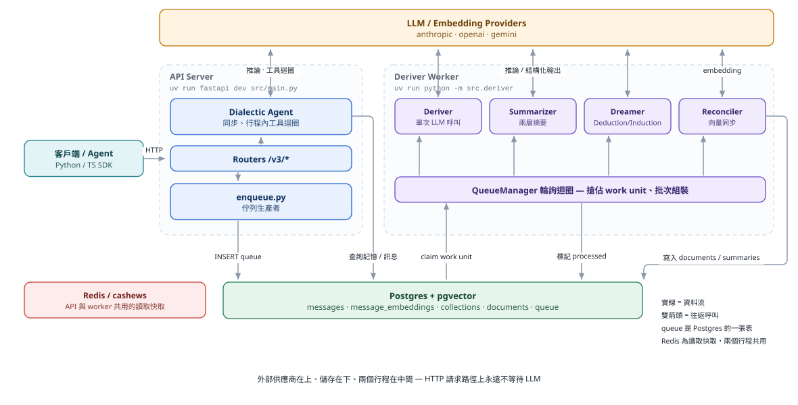
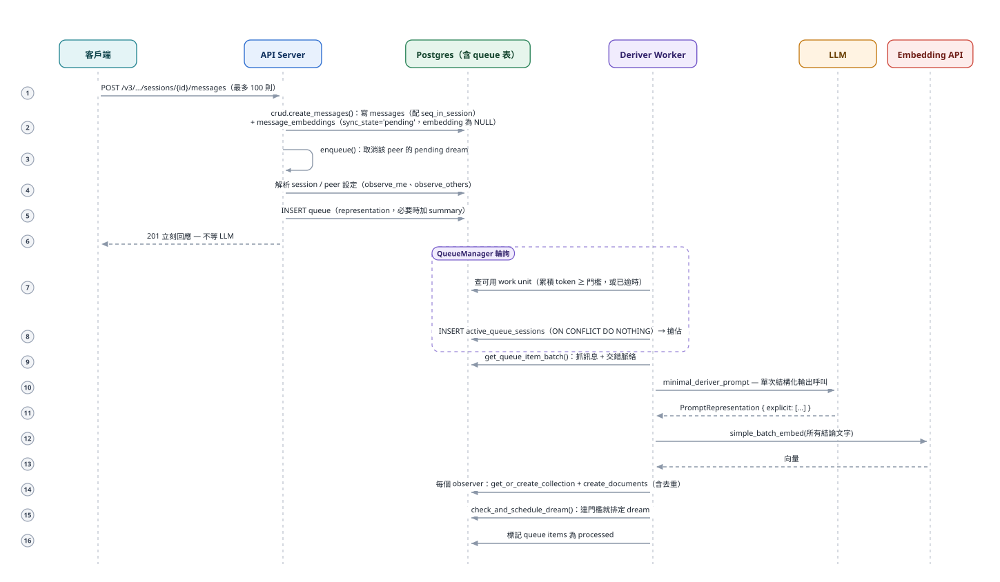
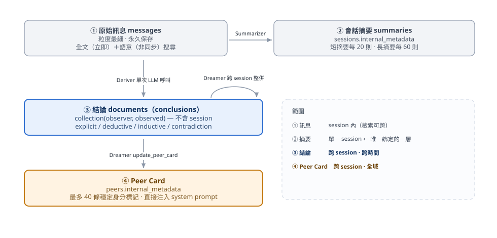

# 跨 Session、跨電腦、跨使用者的知識庫 server：選型與推薦

> 角色設定：本文以「業務」的口吻向你推銷我挑中的方案，所以語氣偏正面。
> 但每個賣點都附證據來源，缺點也放在獨立章節，不藏。
>
> **揭露偏誤**：Honcho 我是讀原始碼讀到函式層級（見同目錄的 `ARCHITECTURE.md`）。
> 其他專案我只讀到官方 README 與第三方比較文，深度不對等。這會讓我對 Honcho 的優缺點掌握得比別人準，
> 也可能讓它顯得更有利。下面的 PoC 建議就是為了抵銷這個偏誤。

---

## 1. 你的需求

| # | 需求 | 白話 |
|---|---|---|
| R1 | server 型 | 不是只能在本機跑的 library，要有可被網路存取的服務 |
| R2 | 跨 session | 新對話讀得到舊對話學到的東西 |
| R3 | 跨電腦 | 辦公室、家裡、雲端 agent 連到同一份記憶 |
| R4 | 跨使用者 | 多人各有記憶，彼此隔離；必要時能共享 |
| R5 | 可自架 | 資料留在自己手上 |

## 2. 候選名單

「ai-memory」這個名字我沒有搜到單一專案，它比較像一個類別名稱。
實際入圍的是下面這些（星數與授權取自各 GitHub 頁面，抓取時間為本文撰寫當日）：

| 專案 | 星數 | 授權 | R1 server | R2 跨 session | R3 跨電腦 | R4 跨使用者 | R5 自架 |
|---|---|---|---|---|---|---|---|
| **Honcho** | 約 7.9k | AGPL-3.0 | 是（FastAPI + 背景 worker） | 是，資料模型天生跨 session | 是，HTTP + JWT | **是，有 5 種作用域與具名 scope key** | 是 |
| Hindsight | 約 56.9k | MIT | 是（Docker / Helm） | 是 | 是 | 以 bank 隔離；auth 模型文件很薄 | 是 |
| Mem0 | 約 68.2k | Apache-2.0 | 是（Docker Compose） | 是 | 是 | 以 `user_id` 區分，自架預設有 API key | 是 |
| Cognee | 約 33.0k | Apache-2.0 | 是（API + MCP） | 是 | 是 | **多租戶存取控制，預設開啟** | 是 |
| Graphiti（Zep 引擎） | 約 32.4k | Apache-2.0 | 官方 server 僅供參考，**無 auth** | 是 | 需自建 | 需自建 | 是，但要自己包 |
| Letta | 約 25.3k | Apache-2.0 | 舊 V1 server 已封存，現行重心在 letta-code | 是 | 靠 Letta Cloud | 文件未提 | 不明確 |
| mcp-memory-service | 約 2.1k | Apache-2.0 | 是 | 是 | 是（Hybrid 同步） | 無真正多使用者隔離，單人維護 | 是 |

出處：
[Honcho](https://github.com/plastic-labs/honcho)、
[Hindsight](https://github.com/vectorize-io/hindsight)、
[Mem0](https://github.com/mem0ai/mem0)、
[Cognee](https://github.com/topoteretes/cognee)、
[Graphiti](https://github.com/getzep/graphiti)、
[Letta](https://github.com/letta-ai/letta)、
[mcp-memory-service](https://github.com/doobidoo/mcp-memory-service)。

第三方比較文（多為廠商自家撰寫，只當方向參考）：
[Cognee 的比較](https://www.cognee.ai/best-open-source-ai-memory-tools-for-llm-agents-and-developers)、
[Hindsight 的比較](https://hindsight.vectorize.io/blog/2026/08/11/open-source-agent-memory-systems)、
[Vectorize 的八套框架比較](https://vectorize.io/articles/best-ai-agent-memory-systems)、
[mcp.directory 的比較](https://mcp.directory/blog/mem0-vs-letta-vs-zep-vs-cognee-2026)。

**淘汰理由**
- Graphiti：官方 README 明說 reference server 沒有認證與授權，且任何呼叫者可讀寫任何 `group_id`。你要自己補整層多租戶。
- Letta：自架 V1 server 已封存，現行 README 把跨電腦記憶導向 Letta Cloud，不符 R5。
- mcp-memory-service：README 自述一人維護，且沒有描述真正的多使用者隔離。適合個人，不適合團隊。

剩下四個是真正的競爭者：**Honcho、Hindsight、Mem0、Cognee**。

---

## 3. 我推薦：Honcho

### 3.1 一句話

Honcho 不是「幫你存向量」的資料庫，而是**會自己讀對話、寫下結論、在你需要時把結論找回來的記憶 server**。
你把訊息丟進去，它在背景整理成「這個人是誰、喜歡什麼、說過什麼」，之後用一個 chat API 問就好。

### 3.2 為什麼它最符合你的四個需求

**跨 session：這是資料模型的結果，不是功能開關。**
記憶容器的唯一鍵是 `(observer, observed, workspace)`，裡面**沒有 session**。
你開第 100 個新 session，Honcho 寫入與讀取的仍然是同一個容器。
你不用做任何設定，新對話就讀得到舊記憶。需要「只看這個 session」反而才要加參數。
（細節見 `ARCHITECTURE.md` 第 13 章。）

**跨電腦：它本來就是 HTTP server。**
任何一台機器只要有網址和金鑰，就連到同一份記憶。官方 SDK 有 Python 與 TypeScript，
另有 CLI，並有 Claude Code、Codex、Cursor、OpenCode、Hermes 等 agent 的第一方外掛或 MCP 支援
（[Honcho README](https://github.com/plastic-labs/honcho)）。你的筆電、桌機、雲端 agent 共用同一個後端，沒有同步問題，因為只有一份資料。

**跨使用者：多層隔離加上明確的共享機制。**
- 最上層 `workspace` 是租戶邊界。幾乎所有複合外鍵都帶 `workspace_name`，
  跨租戶外洩在資料庫 schema 層就不可能，不靠應用層記得加 `WHERE`。
- 每個使用者與 agent 都是 `peer`。認證用 JWT，可限縮到 workspace、peer、session 三個層級；
  3.4 起還有「綁定單一 named scope」的 key，並用獨立的 JWT audience，舊版 server 會拒絕而不是放行。
- 共享不是「全部攤開」，而是可控的：多人同場的 session 用 `observe_me` / `observe_others` 決定誰建模誰；
  3.5 起可把多個 session 放進一個 scope 做受限的共享 recall。

**可自架：Postgres 加 pgvector，沒有雲端綁定。**
官方 docker-compose 範本一個指令起得來（見 `docker-compose.yml.example`）。

### 3.3 整體架構（一張圖）

兩個行程共用 Postgres 與 Redis：

| 元件 | 做什麼 | 為什麼對你有利 |
|---|---|---|
| API server | 收訊息、入列後立刻回應；同步執行 chat（Dialectic） | 寫入延遲不被 LLM 拖慢 |
| Deriver worker | 從佇列取工作：萃取結論、做摘要、做夢整併 | 可水平擴展，多實例安全 |
| Postgres + pgvector | 訊息、結論、向量、佇列全在同一個庫 | 一個要備份的東西 |
| Redis | 讀取快取 | 選用，可關 |
| LLM provider | 萃取與回答用 | anthropic / openai / gemini 皆可，每個 agent 可獨立選模型與 fallback |

### 3.4 記憶是怎麼形成的

四層記憶，各管一段時間尺度：

1. **原始訊息**：立即可全文搜尋，語意搜尋稍後由 reconciler 補向量。
2. **會話摘要**：每 20 則短摘要、每 60 則長摘要，滾動累積。
3. **結論**：Deriver 萃取直接事實；閒置後 Dreamer 再推導出演繹與歸納結論，並記下前提，形成可回溯的推理樹。
4. **Peer card**：最多 40 條穩定身分標記，直接注入 prompt，零檢索成本。

### 3.5 賣點清單（附證據）

| 賣點 | 證據 |
|---|---|
| 寫入路徑不阻塞於 LLM | `enqueue.py` 入列後回應；`deriver/` 為獨立行程 |
| 一次 LLM 呼叫、寫進 N 個觀察者的記憶 | 單筆 queue item 帶 observers 清單；多視角建模的邊際 LLM 成本為零 |
| 成本可預測 | 記憶形成是單次結構化輸出，不是 agent loop；三重 token 批次閘門 |
| 可稽核 | 每條結論記 `message_ids`，並可回溯 `source_ids`；3.5 起 API 回傳 `source_message_ids`，可反查「哪些結論引用了這則訊息」 |
| 租戶隔離在 schema 層 | 複合外鍵含 `workspace_name` |
| 回答成本可調 | chat 有 minimal 到 max 五級，從 1 次迭代、2 個工具到 10 次迭代 |
| 活躍維護 | 本分支同步的 upstream 在 2026-10-29 發了 3.5.0，過去數週有數百個 commit |

---

## 4. 誠實的缺點

業務不會講的部分。每一條都對應到我讀過的程式碼。

| 嚴重度 | 缺點 | 影響 |
|---|---|---|
| 高 | **不會遺忘，檢索排序不看時間** | 使用者先說「住 NYC」，三個月後說「搬到 SF」，兩條並存。`contradiction` 只記錄矛盾，不作廢舊的。清理靠 Dreamer 主動刪除，沒有保證 |
| 高 | **記憶是自然語言，不能做結構化聚合** | 「列出他提過的所有城市」只能靠語意搜尋近似，受 top-k 截斷 |
| 高 | **從說出口到變成長期洞見的鏈路很長** | 全文搜尋立即可用；結論要累積 512 token 或等 30 分鐘；演繹與歸納要滿 50 條 explicit、閒置 60 分鐘、距上次 8 小時。「剛說完下一句就要記得」要靠 session history 注入，不是靠結論層 |
| 中 | **授權是 AGPL-3.0** | 自家內部使用沒問題；若你要把改過的版本做成對外服務，必須公開改動。要讓法務看過 |
| 中 | **要養四個東西** | Postgres（含 pgvector）、Redis（可選）、API、deriver，外加 LLM API key，且 LLM 成本是持續性的 |
| 中 | **檢索沒有 rerank** | prefetch 是固定的純向量搜尋；結論數上千後，中等相關但關鍵的記憶可能撈不到 |
| 中 | **Dream 排程在重度與輕度使用者兩頭都可能不觸發** | 重度者永遠湊不到 60 分鐘閒置；輕度者湊不到 50 條 |
| 中 | **Dream 計時器在 worker 行程記憶體內** | worker 重啟後待執行的 dream 計時全消失，要等下次寫入才重排 |
| 低 | **佇列建在 Postgres 且是輪詢** | 流量很大時 DB 同時是瓶頸與單點 |
| 低 | **2026-10 的 breaking change** | 更新 workspace `configuration` 現在是整份取代，不是合併 |

完整分析見 `ARCHITECTURE.md` 第 17 章。

---

## 5. 與三個真正對手的比較

我只讀到 README，所以這一節的深度不如上面。

| | Honcho | Hindsight | Mem0 | Cognee |
|---|---|---|---|---|
| 記憶模型 | 結論加推理樹加 peer card | 世界事實、經驗、觀察、心智模型，四路平行檢索再 rerank | 向量為主，新演算法含實體連結 | 知識圖譜加向量加關聯式中繼資料 |
| 多使用者 | workspace / peer / session / scope，JWT 分級 | 以 bank 隔離；auth 文件薄 | `user_id`；自架預設有 API key | 預設多租戶，需認證，有權限指南 |
| 儲存 | Postgres + pgvector | Postgres + pgvector 或 Oracle | 預設 Qdrant | 可全放單一 Postgres（README 稱此為 demo 級） |
| 授權 | AGPL-3.0 | **MIT** | Apache-2.0 | Apache-2.0 |
| 星數 | 約 7.9k | **約 56.9k** | **約 68.2k** | 約 33.0k |
| 強項 | 跨 session 是預設；可稽核；多視角成本低 | 寬鬆授權；檢索設計完整；自稱 LongMemEval 領先 | 生態最大、上手最快 | 圖譜與權限 |
| 弱項 | AGPL；星數最少；不看時間 | 多租戶 auth 模型不明 | 多租戶與隔離細節 README 未述 | 生產級 Postgres 圖譜是授權產品 |

**關於基準測試分數：全部不可信到足以決策。** 各家 LongMemEval 數字多為自己公布，
設定不一致，第三方文章給的數字互相矛盾（例如 Zep 同時出現 63.8% 與 71.2%）。
Hindsight 聲稱有維吉尼亞理工的獨立重現，但我沒有查證原始論文。
請以 [LongMemEval 原論文](https://arxiv.org/abs/2410.10813) 與你自己的資料為準。

### 什麼情況下我會改推別人

- **授權是硬限制（要改碼並對外提供服務）**：改選 **Hindsight**（MIT）。
- **要最大生態、最快上手、使用者隔離需求簡單**：**Mem0**。
- **記憶主要是文件與知識關聯，而非對話中的人**：**Cognee**。

---

## 6. 建議的導入方式

不要只靠我的推薦就決定。花兩天做 PoC：

1. `docker compose up` 起 Honcho，另用同一組資料起 Hindsight 與 Mem0。
2. 用你自己的 20 到 30 段真實對話灌入。
3. 驗收四件事：
   - 開新 session，能否答出舊 session 的事實。
   - 在另一台電腦用同一個 URL 與金鑰，能否讀到。
   - 用 A 使用者的 key 讀 B 使用者的資料，**是否被擋下**（這是安全底線）。
   - 對「使用者改變主意」的案例，回答是否取到新的、而不是舊的。第 4 項是三個系統都要驗的共同弱點。
4. 記錄每則訊息的 LLM 成本。

---

## 7. 最後

如果你的核心場景是「**同一個人或同一群 agent，跨長時間、跨裝置、跨 session 累積對使用者的理解**」，
而且你重視可稽核與多視角，Honcho 是這批裡設計最貼題的一個。
它最大的代價是 AGPL 與「不會遺忘」。這兩點先確認你能接受，再往下走。
