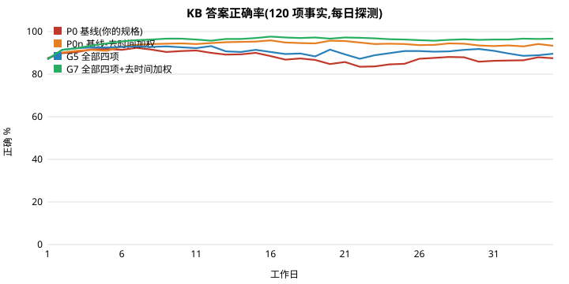
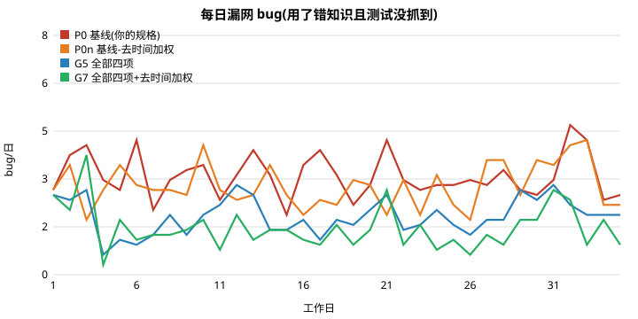

# 多人共用 Memory DB:怎么治理(v2 实验)

## 先讲结论(照这个做)

你的原始规格(同 key 覆盖、不同子 key 追加、有时间加权、有 source path)**不够**。100 人用 35 个工作日:正确率停在约 87%,第 5 天后还缓慢下滑,不会收敛。

加上下面 4 件事,正确率升到约 **96%**,「错的但没警示」从 3.9% 降到 0.6%,每日漏网 bug 从 3.27 降到 1.55(约减半):

| 优先级 | 机制 | 不需要 LLM 的做法 | 解决什么 |
|---|---|---|---|
| 1 | **检索不要用时间衰减排序** | 只用 BM25 选条目;时间只用来「同 key 冲突」时选新的 | 时间加权让「较新的兄弟条目/旧垃圾」压过正确条目,缺失率 2% → 9% |
| 2 | **commit hook(推)** | 提交改到某文件时,列出 `source path` 指向该文件的条目,要求改的人更新 | 知识过期的主因是「改代码的人不回写」(回写率 60% → 92%) |
| 3 | **过期警示(拉)** | 条目存写入时文件版本(git hash);读取时文件已变 → 标「可能过期」,读者去核对 | 没人更新时,读者至少知道要验证 |
| 4 | **使用结果回馈** | 用了某条知识后测试失败 → 标 `refuted`;被 ≥2 次验证过的条目,单人覆盖先变 `disputed`,第二人确认才覆盖 | 防「一个误读的人把对的覆盖成错的」(错覆盖 1.32 → 0.61/日) |
| 可选 | 规范 key(写入时只能选已有 key) | 工具强制 | 本实验没测出明显好处,先不做 |

代价:每人每日多读代码验证,约 +8%(23 → 25 次/日,全体)。

## 实验怎么设计(照你说的)

- **代码**:程序生成 12 个模块、36 个文件、120 个事实(如 `RETRY_LIMIT = 3`;30% 是推导值 `X = BASE + 2`,较难读)。真的写成 `.py` 文件,模拟前后各 `exec` 一次,确认事实表与代码一致(`sim2.py` 主程序)。
- **KB 初版**:覆盖 90% 事实,其中 8% 是错的。
- **100 人**:全是白纸。25 人是**转述者**:只查、转述,不改代码也不写 KB;开发者 30% 的查询经转述者,转述有 6% 失真、警示 50% 丢失。75 人是开发者。
- **每日(离散时间,一人接一人,每日洗牌)**:开发者做一个任务,查 1–3 个事实 → 按 KB 答案动手 → 测试(70% 抓得到错)→ 失败才读代码、**用读到的修正 KB**。40% 任务会改代码,其中 15% 真的改变某个事实的值(代码持续演进,KB 随之过期)。
- **人的差异**:读代码有误读率(技能、难度决定,误读后同一人同一事实持续误读);回写意愿平均 60%;默认几乎全信 KB(平均 6% 会主动核对)。
- **KB 规格**:SQLite FTS5 bm25;同 key 覆盖;写入偶尔用了变体 key(12%)→ 变成追加、留下旧条目;每条有时间戳、source path;闲聊噪音会被写入。
- 35 天,每个策略 6 个随机种子,表中数字取第 25–35 天均值。

## 结果





主要比较(第 25–35 天均值,6 种子):

| 策略 | 正确% | 静默错% | 缺失% | 用到错答/日 | 漏网 bug/日 | 读码/日 | 错覆盖/日 |
|---|---|---|---|---|---|---|---|
| P0 你的规格 | 86.9 | 3.9 | 9.1 | 8.2 | 3.27 | 23.3 | 0.59 |
| P0n 规格去时间加权 | 93.7 | 4.2 | 2.0 | 7.0 | 3.23 | 18.8 | 0.59 |
| G1 过期警示 | 88.1 | 1.6 | 7.4 | 7.8 | 2.56 | 31.2 | 0.85 |
| G2 commit hook | 89.1 | 2.3 | 8.6 | 5.1 | 2.65 | 21.4 | 0.73 |
| G3 使用结果回馈 | 86.9 | 2.7 | 8.7 | 7.9 | 2.76 | 27.5 | 0.38 |
| G4 规范 key | 86.8 | 3.9 | 9.3 | 7.7 | 3.17 | 22.2 | 0.65 |
| G5 四项全开 | 90.4 | 0.8 | 7.8 | 4.2 | 2.12 | 30.4 | 0.61 |
| **G7 四项全开 + 去时间加权** | **96.3** | **0.6** | 1.9 | **2.5** | **1.55** | 25.1 | 0.39 |
| G8 去规范key + 去时间加权 | 95.1 | 0.4 | 2.3 | 5.0 | 1.73 | 28.4 | 0.36 |

读法:
- **「静默错」** = KB 给错答且没任何警示,最危险。
- **「缺失」** = 查不到正确条目(被兄弟/噪音/变体 key 顶掉)。P0 的 9% 缺失主要来自时间加权。
- **「漏网 bug」** = 照错知识做了且测试没抓到。

### 消融(G5 各去掉一项,不含去时间加权)

| 去掉 | 静默错% | 用到错答/日 | 错覆盖/日 | 读码/日 |
|---|---|---|---|---|
| (全开 G5) | 0.8 | 4.2 | 0.61 | 30.4 |
| commit hook | 0.5 | 7.3 | 0.50 | 33.2 |
| 过期警示 | 0.8 | 3.7 | 0.38 | 22.6 |
| 使用结果回馈 | 1.9 | 5.3 | 1.32 | 29.8 |
| 规范 key | 0.4 | 5.0 | 0.52 | 32.2 |

- commit hook 去掉后,用到错答几乎翻倍(4.2 → 7.3):它最能降低错答。
- 结果回馈去掉后,错覆盖翻倍(0.61 → 1.32):它专防「对的被改错」。
- 过期警示与规范 key 在有其他三项时,边际贡献**看不出来**(差异在种子噪声内)。过期警示单独用有效(静默错 3.9 → 1.6),但代价是读码 +34%(假警示多:同文件任一事实改动,都会让该文件所有条目变「过期」)。

### 压力测试(P0 / G6=G1+G2 / G5 对照)

| 情境 | P0 静默错% | G5 静默错% | P0 漏网/日 | G5 漏网/日 |
|---|---|---|---|---|
| 基础 | 3.8 | 0.8 | 3.27 | 2.32 |
| 代码变动 x2 | 7.0 | 0.6 | 4.48 | 2.00 |
| 回写意愿低(0.3) | 8.6 | 0.2 | 5.84 | 1.91 |
| 误读 x2 | 7.0 | 1.2 | 4.98 | 3.07 |
| 测试抓漏低(0.4) | 5.5 | 0.2 | 7.59 | 3.30 |
| 警示采信低(0.4) | 3.8 | 0.5 | 3.27 | 1.82 |
| 转述者 50% | 5.0 | 1.1 | 2.70 | 1.68 |
| 初始错误 25% | 4.3 | 0.5 | 3.07 | 1.80 |

所有情境排序一致:治理版优于你的规格;变动越快、回写越懒,差距越大。

## 实验没解决的

1. **漏网 bug 降不到 0**。剩下的主要来自「测试没抓到」(p=0.7)和「读码误读」。KB 治理改不了这两点;测试抓漏率降到 0.4 时,即使全开仍有 3.3/日。
2. **误读者会把对的覆盖成错的**(错覆盖仍有 0.4/日)。结果回馈只能拦下一部分。
3. **变体 key 留下的旧条目不会被清**(幽灵条目)。需要定期报表:同模块、同 source path、key 相近的条目列出人工合并。本实验没做自动合并。
4. 过期警示的假警示率高。建议 source path 精确到行区间(`file:L10-30`)并比较该区间的 hash,不要只比整个文件。

## 局限(请照这个打折)

- **人是规则模拟,不是 LLM**。参数(误读率、回写率、测试抓漏率、采信警示率)是假设值;只有部分参考上一轮 Haiku 实验。绝对数字不要当预测,看**相对排序与哪个机制有用**。
- 只测 6 个种子;差异小于约 1 个百分点的,视为噪声。
- 代码是合成的常量/推导值,真实项目的知识(设计原因、流程)更难判断对错。
- 未模拟图片等非文字知识(前一轮已另测)。
- 想把「人」换成 Haiku(70% low / 30% medium)再跑一轮,可复用 `poc/social-sim/llm/` 的框架;成本约 700 万 tokens/策略。

## 复现

```bash
cd poc/social-sim/v2
python3 sim2.py      # 单次冒烟:生成代码并校验
python3 run2.py      # 主网格 + 消融 + 压力测试 → results2.json
python3 run2b.py     # 去时间加权变体 → results2b.json
python3 summ2.py     # 打表
```
